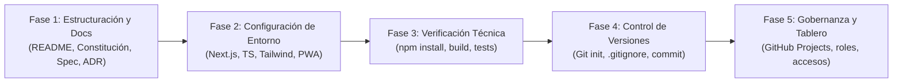

# Planificación, Tareas e Implementación · Habilitadores Sesión 8

**Proyecto:** Red de Rescate de Alimentos  
**Organización Cliente:** Fundación Mesa Común (Cali, Colombia)  
**Equipo de Desarrollo:** Nexo Cívico Studio (Equipo 3)  
**Fecha de Ejecución:** 26 de septiembre de 2026 (Sesión 8)  
**Asistente IA:** Antigravity (Gemini 3.8 Flash & Claude 4.6 Opus)  

---

## 1. Contexto y Objetivos de la Sesión

En la Sesión 8 del Módulo 3 de Proyecto Informático 2 (Universidad Autónoma de Occidente), el objetivo fundamental es dejar **100% operativos los 5 habilitadores de ingeniería** antes de iniciar la escritura de código del incremento en la Sesión 10:

1. **Repositorio:** Estructurado formalmente según la guía `Módulo 3 · Referencia`, con README inicial y acceso de lectura para el docente (César Augusto Navia Rojas).
2. **Tablero:** En GitHub Projects con los cuatro estados canónicos (`Por hacer`, `En curso`, `En revisión`, `Terminado`) y trazabilidad estricta a los comportamientos del MVP.
3. **Entorno:** Scaffolding reproducible en local (Next.js 14, TypeScript estricto, Tailwind CSS y soporte PWA) levantable por los 6 integrantes del equipo sin fricción.
4. **Accesos:** Responsabilidades y permisos distribuidos para eliminar puntos únicos de falla.
5. **Agente de IA y Constitución:** Convención formal de uso de Antigravity (Gemini 3.8 Flash / Claude 4.6 Opus) y acuerdo de las Definiciones de Listo (DoR) y Terminado (DoD), ampliadas con dos criterios propios justificados por lista.

---

## 2. Diagnóstico de Insumos y Trazabilidad

Antes de realizar cualquier cambio en el repositorio, se extrajo y analizó a profundidad la documentación de las fases anteriores:

### 2.1. Insumos del Módulo 1 (El "Qué"):
- **Problema central:** Desperdicio de comida apta para consumo en restaurantes y galerías de mercado de Cali (Santa Elena, Cavasa, Alameda, Caicedo), en contraste con comedores comunitarios con escasez o pérdidas por falta de refrigeración (antecedente crítico: 230 kg de tomate perdidos).
- **Colapso del canal actual:** La coordinación por WhatsApp provocaba pérdida de mensajes, doble desplazamiento de voluntarios al mismo comercio y reportes manuales imprecisos que arriesgaban la continuidad de los fondos de la Fundación Carvajal y el Fondo Internacional.
- **Requerimientos núcleo:** `RF-001` y `RF-017` (publicación en <1 min con exención legal Ley 1990/2019), `RF-002` (consulta de estado y trazabilidad), `RF-003` y `RF-004` (coordinación de voluntarios con reserva única), `RF-005` y `RF-006` (registro de entrega), `RF-014` (filtro estricto por cadena de frío) y `RNF-001` a `RNF-005` (usabilidad móvil en <3 pasos, resiliencia offline y TCO de $0 USD/mes).

### 2.2. Insumos del Módulo 2 (El "Con Qué"):
- **Alternativa seleccionada:** **Alternativa A — Aplicación Web Progresiva (PWA) Serverless** (Calificación: **4.68 / 5.0**, 159 pts ponderados).
- **Justificación de descarte:**
  - *App Nativa (2.85):* Descartada por costos de tiendas de apps ($99 USD/año en Apple, $25 USD en Google), necesidad de mantener un VPS dedicado y la fricción de exigir descargas de 50 MB en celulares de gama baja con planes de datos limitados.
  - *WhatsApp Bot con IA (2.38):* Descartado por costos variables por tokens/mensajes que rebasaban el presupuesto de $150.000 COP/mes, falta de soporte fuera de línea (nula conectividad en plazas de mercado) y riesgo de alucinaciones en datos de perecederos.

---

## 3. Plan de Trabajo Descompuesto (Fases y Tareas)

Para materializar los habilitadores de forma ordenada, se estructuró la siguiente descomposición de trabajo:

### Detalle de Tareas Ejecutadas:

#### Fase 1: Arquitectura Documental y Especificación
- [x] **T-01:** Diseñar la estructura canónica de directorios del repositorio (`docs/spec/`, `docs/decisiones/`, `src/`, `tests/`).
- [x] **T-02:** Redactar [`README.md`](../README.md) cumpliendo las directrices pedagógicas: lenguaje orientado al cliente, instrucciones de despliegue paso a paso, enlaces relativos a la especificación y declaración obligatoria de IA.
- [x] **T-03:** Redactar [`docs/spec/constitucion.md`](spec/constitucion.md) formalizando la asignación de los 6 roles, convenciones de Git/commits/PRs, política de auditoría de IA, y las definiciones de Listo (DoR) y Terminado (DoD) con criterios propios justificados.
- [x] **T-04:** Especificar en [`docs/spec/comportamientos.md`](spec/comportamientos.md) los 5 comportamientos centrales del MVP (`CMP-01` a `CMP-05`) en formato BDD/Gherkin trazados a los requerimientos del Módulo 1.
- [x] **T-05:** Documentar en [`docs/spec/plan-tecnico.md`](spec/plan-tecnico.md) la arquitectura Serverless, modelo relacional en PostgreSQL/Supabase y sincronización offline.
- [x] **T-06:** Elaborar [`docs/decisiones/ADR-001-bloqueo-atomico-segunda-toma.md`](decisiones/ADR-001-bloqueo-atomico-segunda-toma.md) resolviendo el problema de concurrencia y doble asignación mediante funciones RPC con bloqueo pesimista (`SELECT ... FOR UPDATE`).

#### Fase 2: Configuración del Entorno de Desarrollo
- [x] **T-07:** Configurar [`package.json`](../package.json) con Next.js 14, React 18, TypeScript, Tailwind CSS, `@supabase/supabase-js` y `lucide-react`.
- [x] **T-08:** Configurar [`tsconfig.json`](../tsconfig.json) con tipado estricto (`strict: true`) y alias de ruta `@/*`.
- [x] **T-09:** Configurar [`next.config.mjs`](../next.config.mjs), [`tailwind.config.ts`](../tailwind.config.ts) con la identidad visual de Nexo Cívico y [`postcss.config.mjs`](../postcss.config.mjs).
- [x] **T-10:** Crear [`.env.example`](../.env.example) con las variables de conexión públicas y privadas de Supabase.
- [x] **T-11:** Implementar el modelo de dominio en [`src/types/index.ts`](../src/types/index.ts) con interfaces estrictas (`Donacion`, `Organizacion`, `Usuario`, `EstadoDonacion`).
- [x] **T-12:** Construir el frontend de aterrizaje en [`src/app/page.tsx`](../src/app/page.tsx), [`src/app/layout.tsx`](../src/app/layout.tsx) y [`src/app/globals.css`](../src/app/globals.css) reflejando el estado de los habilitadores y los 5 comportamientos.

#### Fase 3: Pruebas y Validación de Compilación
- [x] **T-13:** Crear suite de pruebas unitarias en [`tests/mvp-rules.test.ts`](../tests/mvp-rules.test.ts) validando las compuertas de exención legal (`CA-01.2`) y exclusión mutua concurrente (`CA-03.1` y `CA-03.2`).
- [x] **T-14:** Ejecutar `npm install` localmente para instalar y auditar el árbol de dependencias.
- [x] **T-15:** Ejecutar `npm run build` certificando cero errores de compilación, verificación de tipos e inferencia estática exitosa.

#### Fase 4: Control de Versiones y Exclusión de Entregables
- [x] **T-16:** Crear [`.gitignore`](../.gitignore) blindando archivos de entorno, dependencias y excluyendo formalmente la carpeta de entregables académicos `Contenido/` y notas temporales `scratch_docs/`.
- [x] **T-17:** Inicializar repositorio Git local en rama `main` y registrar el commit inicial atómico: `c770f3a: chore(init): inicializar estructura del repositorio, habilitadores, README y constitucion`.

#### Fase 5: Gobernanza y Publicación del Tablero
- [x] **T-18:** Diseñar la estructura del tablero en GitHub Projects (Project v2) con las cuatro columnas obligatorias y reglas operativas de asignación y trazabilidad.

---

## 4. Detalle de la Implementación Realizada

### 4.1. Repositorio y Reglas de Entrada ([`README.md`](../README.md))
- Redactado para que Marcela Ocampo (sin conocimientos técnicos) entienda de inmediato el propósito de la plataforma.
- Incorpora los comandos precisos para clonar, instalar variables y levantar el servidor de desarrollo local en `http://localhost:3000`.
- Incluye la matriz formal de uso de asistentes de IA (Gemini 3.8 Flash para velocidad/scaffolding y Claude 4.6 Opus para concurrencia y arquitectura).

### 4.2. Constitución del Proyecto ([`docs/spec/constitucion.md`](spec/constitucion.md))
- **Asignación de Roles:**
  - *Product Owner:* Eduard Criollo Yule.
  - *Full-Stack Developer:* Alejandro Rodríguez Cortés.
  - *Backend Developer:* Santiago Valencia Sandoval.
  - *QA Engineer:* Felipe Charria Caicedo.
  - *DevOps Engineer:* Juan Camilo Peña Sandoval.
  - *UX Designer (Soporte):* Juan Sebastián Delgado.
- **Convenciones:** Ramas `feat/` y `fix/` desde `develop`, Conventional Commits (`feat`, `fix`, `docs`, `test`), y PRs con revisión obligatoria por un par distinto al autor.
- **Definiciones DoR y DoD Ampliadas:**
  - *DoR:* 6 bases obligatorias + 1) Definición de sincronización Offline-First en IndexedDB; 2) Validación de exención sanitaria Ley 1990/2019 y cadena de frío.
  - *DoD:* 5 bases obligatorias + 1) Garantía de cero costo recurrente ($0 USD/mes / Free Tier Guardrail); 2) Verificación de bloqueo atómico concurrente en toma de donaciones (Reserva única).

### 4.3. Especificación de los 5 Comportamientos del MVP ([`docs/spec/comportamientos.md`](spec/comportamientos.md))
- `CMP-01`: Registrar donación con tipo, cantidad, dirección, hora límite y exención legal obligatoria (`RF-001`, `RF-017`).
- `CMP-02`: Hacer visible la donación en catálogo en tiempo real con etiqueta de cadena de frío (`RF-002`, `RF-014`).
- `CMP-03`: Toma de donación por voluntario con bloqueo atómico de segunda toma concurrente (`RF-004`, `RF-010`, `ADR-001`).
- `CMP-04`: Registro y confirmación de entrega en comedor comunitario receptor (`RF-005`, `RF-006`).
- `CMP-05`: Consulta de trazabilidad histórica completa (Donante $\rightarrow$ Voluntario $\rightarrow$ Comedor) para cooperantes y coordinación (`RF-002`, `RF-007`).

### 4.4. Decisión Técnica de Concurrencia ([`docs/decisiones/ADR-001-bloqueo-atomico-segunda-toma.md`](decisiones/ADR-001-bloqueo-atomico-segunda-toma.md))
- Resuelve el problema neurálgico del caso: evitar que dos voluntarios se desplacen por la misma oferta.
- Descarta bloqueos en memoria (inviables en lambdas serverless efímeras) y servicios de colas de pago (Redis/RabbitMQ).
- Selecciona bloqueo pesimista en PostgreSQL (`SELECT ... FOR UPDATE`) encapsulado en una función RPC en Supabase, garantizando atomicidad ACID sin costos adicionales.

---

## 5. Protocolo de Verificación para Futuras Tareas

Para garantizar que en todas las sesiones y requerimientos futuros el agente trabaje bajo **planificación previa y control interactivo**:

1. **Parada y Planificación Obligatoria (Gate 0):** Ante cualquier solicitud compleja de desarrollo, arquitectura o refactorización, el asistente generará y presentará en primera instancia un artefacto de plan de implementación y lista de tareas con solicitud de confirmación antes de ejecutar comandos destructivos o modificaciones masivas de código.
2. **Descomposición Atómica:** Cada tarea propuesta deberá cumplir la Definición de Listo (caber en una sesión, trazada a un comportamiento y con criterio verificable).
3. **Puntos de Control:** Al completar cada fase del plan, se presentará el registro de ejecución y la verificación de pruebas correspondiente.
