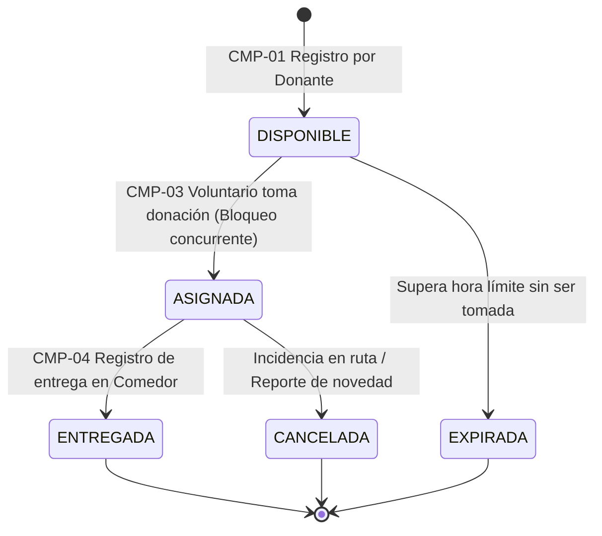

# Especificación de Comportamientos del MVP

**Proyecto:** Red de Rescate de Alimentos
**Organización:** Fundación Mesa Común (Cali, Colombia)
**Equipo:** Nexo Cívico Studio
**Versión:** 2.0 — Módulo 3
**Estado:** Aprobado / Fuente de Verdad Técnica para Tablero y Pruebas

> [!NOTE]
> Este documento describe el comportamiento esperado del sistema en **tiempo presente**. Constituye el contrato técnico ejecutable contra el que se implementan el código, las pruebas automatizadas y los incrementos en los Sprint Reviews. Cada comportamiento mapea a una historia de usuario y a los issues del tablero de GitHub Projects.

---

## Modelo de Estados Determinístico de una Donación

Toda donación en el ciclo de vida del MVP transita por el siguiente ciclo determinístico de estados:



---

## CMP-01 · Un comercio publica una donación

* **Historia (US1.1):** Como comerciante donante, quiero registrar una donación de alimentos con su tipo, cantidad, ventana de recogida y aceptación legal, para que los voluntarios y comedores comunitarios sepan qué hay disponible y cuándo recogerlo.
* **Comportamiento:** `CMP-01` en `comportamientos.md` · **Origen:** `RF-001` (Registro de donación) | `RF-017` (Inocuidad y ventana) | `RNF-001` (Mobile-First) | `RNF-002` (Offline-First)

### Criterios de Aceptación (Gherkin):

```gherkin
Escenario: CA-01.1 Publicación exitosa de oferta con aceptación legal y georreferenciación
  Dado un comercio o donante con sesión iniciada en la plataforma,
  Cuando registra tipo de alimento, cantidad estimada (kg/canastillas), ventana de tiempo,
  Y selecciona la zona urbana de Cali (CENTRO, NORTE, SUR, ORIENTE, LADERA),
  Y fija el punto de recogida mediante mapa interactivo OpenStreetMap o presets de plazas,
  Y opcionalmente detalla indicaciones del puesto/muelle y teléfono de contacto,
  Y marca la casilla obligatoria de exención de responsabilidad sanitaria bajo la Ley 1990 de 2019,
  Y presiona "Publicar Donación",
  Entonces la donación queda creada en estado "DISPONIBLE",
  Y genera un código único de seguimiento (ej. DON-101),
  Y se hace visible de forma inmediata en la lista de ofertas para los voluntarios con su posición geográfica.

Escenario: CA-01.2 Bloqueo por ventana de tiempo inválida (hora límite anterior o igual)
  Dada una ventana de recogida cuya hora límite es anterior o igual a la hora de publicación,
  Cuando el comercio intenta enviar el formulario,
  Entonces el sistema impide el registro,
  Y muestra un mensaje de validación indicando que la hora límite de recogida debe ser posterior a la hora actual.

Escenario: CA-01.3 Bloqueo por omisión y resaltado visual de advertencia legal (Normativa Colombiana)
  Dado que el comerciante diligencia el formulario de registro de donación en "/donar",
  Cuando visualiza el bloque de declaración juramentada de inocuidad y responsabilidad legal,
  Entonces el sistema exhibe un contenedor de alta visibilidad (borde semántico ámbar/esmeralda, icono de escudo legal y contraste >= 4.5:1 WCAG AA) que cita explícitamente la obligatoriedad de cumplir con la Ley 1990 de 2019 (política contra la pérdida y desperdicio de alimentos y exoneración de responsabilidad), la Resolución 2674 de 2013 del Ministerio de Salud / INVIMA (requisitos sanitarios de inocuidad) y la Ley 1581 de 2012 (Habeas Data),
  Y cuando intenta presionar "Publicar Donación" sin marcar la casilla obligatoria, el sistema bloquea el envío, desplaza el foco al aviso legal y aplica un estado de alerta visual ("ring-2 ring-red-500") con el mensaje: "El cumplimiento y aceptación expresa de la normativa sanitaria y legal colombiana es obligatorio para publicar donaciones".

Escenario: CA-01.4 Marcado de cadena de frío y etiqueta explícita de "Temperatura Ambiente"
  Dado un lote de alimentos en proceso de registro o publicado en el catálogo y radar logístico,
  Cuando el alimento requiere cadena de frío (requiereFrio = true),
  Entonces el sistema asigna y renderiza la etiqueta destacada "Requiere Refrigeración (0°C - 4°C)" y restringe su canalización a comedores con refrigeración funcional,
  Y cuando el alimento no requiere refrigeración (requiereFrio = false),
  Entonces el sistema asigna y renderiza explícitamente en el selector del formulario, tarjetas del catálogo y tablas operativas la etiqueta canónica "Temperatura Ambiente", erradicando abreviaturas ambiguas como "No (amb)" o "NO (AMB.)".

Escenario: CA-01.5 Generación determinista de código único offline y reconciliación sin colisiones
  Dado que el donante se encuentra en una plaza de mercado (Santa Elena o Cavasa) sin conexión a Internet (navigator.onLine = false),
  Cuando completa y envía el formulario de donación,
  Entonces el sistema genera localmente un código único determinista bajo el formato "OFFLINE-DON-<YYMMDD>-<DEV4>-<SEQ3>-<ENT4>" (donde YYMMDD es la fecha local UTC-5, DEV4 son 4 caracteres hexadecimales de la huella persistente del dispositivo, SEQ3 es el secuencial diario local 001..999 y ENT4 son 4 caracteres base36 de entropía criptográfica) junto con una llave de idempotencia UUID v4 (idempotency_key),
  Y almacena la donación en IndexedDB (Dexie.js) mostrando la confirmación: "Guardado localmente — pendiente de sincronización",
  Y al restablecerse la conexión, el servidor verifica idempotency_key para prevenir duplicados, asigna el código secuencial canónico definitivo "DON-XXX", preserva el código local en codigo_origen_offline para trazabilidad forense, y actualiza reactivamente la interfaz del donante sin requerir recargar la página.
```

* **Se prueba como:** `comercio / donante` · `teléfono`

### Definición de Terminado (DoD Específico):

- [x] Cumple todos sus criterios de aceptación (`CA-01.1` a `CA-01.5`).
- [x] El código está revisado y aprobado por otro integrante (Peer review / QA).
- [x] Tiene pruebas automatizadas y todas pasan.
- [x] Está integrada en `main` sin romper la compilación (`npm run build` en verde).
- [x] La documentación afectada está actualizada en `docs/spec/`.
- [x] Pasan las dos pruebas de gobierno (cero datos inventados y consentimiento legal sin captura de datos sensibles).
- [x] Se probó entrando con el rol real de donante en dispositivo móvil (viewport celular).

---

## CMP-02 · Visualización y filtrado de donaciones disponibles

* **Historia (US2.1):** Como voluntario de transporte u organización receptora, quiero consultar las donaciones activas filtradas por cercanía geográfica y requerimiento de refrigeración, para identificar rápidamente qué alimentos puedo rescatar según mi capacidad instalada.
* **Comportamiento:** `CMP-02` en `comportamientos.md` · **Origen:** `RF-002` (Consulta de estado) | `RF-014` (Cadena de frío) | `RNF-001` (Mobile-First)

### Criterios de Aceptación (Gherkin):

```gherkin
Escenario: CA-02.1 Visualización reactiva de ofertas vigentes y excedentes en mapa
  Dado que existen donaciones en la base de datos con estado "DISPONIBLE" y ventana vigente,
  Cuando un voluntario o comedor receptor abre el catálogo móvil,
  Entonces el sistema muestra únicamente las donaciones en estado "DISPONIBLE",
  Y presenta para cada una: donante, tipo de alimento, cantidad en kg, zona de Cali y temporizador restante,
  Y ofrece la opción de desplegar el mapa interactivo OpenStreetMap (Leaflet),
  Proyectando cada excedente disponible como un marcador cartográfico con código, producto, peso y bandera de frío,
  Con fallback automático al centro de la zona de Cali si la oferta no incluyó GPS manual.

Escenario: CA-02.2 Identificación destacada de cadena de frío
  Dado que una oferta activa contiene alimentos con el indicador requiereFrio = true,
  Cuando se renderiza en la lista de ofertas,
  Entonces la tarjeta exhibe una etiqueta destacada visual "Requiere Refrigeración",
  Y restringe la asignación para que no sea canalizada a comedores sin nevera funcional.

Escenario: CA-02.3 Filtrado por zona geográfica de Cali y radar multivoluntario con fitBounds
  Dadas donaciones ubicadas en diferentes sectores ("NORTE", "CENTRO", "SUR", "ORIENTE", "LADERA"),
  Cuando el voluntario selecciona un filtro por zona específica,
  Entonces el catálogo filtra en el cliente de forma reactiva mostrando solo las ofertas del sector seleccionado,
  Y el mapa cartográfico OpenStreetMap centra su encuadre en el sector correspondiente,
  Permitiendo a su vez ciclar secuencialmente entre las unidades de transporte de la flota activa (Voluntario 1 -> Voluntario 2),
  O encuadrar a toda la flota en una panorámica colectiva de Cali mediante map.fitBounds(),
  Trazando polilíneas discontinuas diferenciadas por ruta (Ruta 1 verde esmeralda y Ruta 2 azul cielo).

Escenario: CA-02.4 Ocultamiento automático de donaciones expiradas
  Dada una donación cuya hora límite de recogida es superada en el reloj del sistema sin haber sido tomada,
  Cuando expira la ventana temporal,
  Entonces la donación transiciona internamente a estado "EXPIRADA",
  Y desaparece automáticamente del listado de donaciones disponibles sin requerir recarga manual.
```

* **Se prueba como:** `voluntario / comedor receptor` · `teléfono`

### Definición de Terminado (DoD Específico):

- [x] Cumple todos sus criterios de aceptación (`CA-02.1` a `CA-02.4`).
- [x] El código está revisado y aprobado por otro integrante (Peer review / QA).
- [x] Tiene pruebas automatizadas y todas pasan.
- [x] Está integrada en `main` sin romper la compilación.
- [x] La documentación afectada está actualizada en `docs/spec/`.
- [x] Pasan las dos pruebas de gobierno (tiempos y cantidades calculadas desde base de datos, sin cifras inventadas).
- [x] Se probó entrando con el rol real de voluntario/comedor en dispositivo móvil.

---

## CMP-03 · Toma de donación con bloqueo de segunda toma (Reserva Única)

* **Historia (US3.1):** Como voluntario de transporte u organización receptora, quiero reservar de manera exclusiva una donación disponible, para asegurar la recogida sin que otra persona u organización se desplace simultáneamente por la misma carga.
* **Comportamiento:** `CMP-03` en `comportamientos.md` · **Origen:** `RF-004` (Coordinación de recogida) | `RF-010` (Exclusión de colisión) | `RNF-004` (Integridad transaccional y concurrencia)

### Criterios de Aceptación (Gherkin):

```gherkin
Escenario: CA-03.1 Asignación exitosa e indivisible al primer solicitante
  Dada una donación en estado "DISPONIBLE",
  Cuando el voluntario "Juan Pérez" presiona la acción "Tomar Donación",
  Entonces el sistema ejecuta una transacción atómica actualizando el estado a "ASIGNADA",
  Y vincula a "Juan Pérez" como responsable único de la recogida,
  Y registra la fecha y marca temporal exacta (UTC) de la asignación,
  Y muestra en pantalla la dirección completa de recogida y los datos de contacto del donante.

Escenario: CA-03.2 Bloqueo atómico a segunda toma simultánea (Caso Borde Concurrente)
  Dada una donación que acaba de ser asignada al voluntario "Juan Pérez",
  Cuando otro voluntario "Carlos Gómez" intenta presionar en paralelo o milisegundos después "Tomar Donación",
  Entonces la base de datos detecta que el estado ya no es "DISPONIBLE" y rechaza la solicitud de "Carlos Gómez",
  Y el backend responde con un código HTTP 409 Conflict,
  Y la interfaz de "Carlos Gómez" muestra la notificación amigable: "Esta donación acaba de ser reservada por otra persona. Te mostramos las ofertas disponibles más cercanas.",
  Y remueve inmediatamente la tarjeta de la vista de "Carlos Gómez".

Escenario: CA-03.3 Bloqueo de toma sobre ofertas expiradas o canceladas
  Dada una donación que ha pasado a estado "EXPIRADA" o "CANCELADA",
  Cuando cualquier voluntario intenta enviar una petición de toma,
  Entonces el sistema deniega la operación,
  Y emite el mensaje de advertencia: "La oferta seleccionada ya no se encuentra vigente para recogida."
```

* **Se prueba como:** `voluntario de transporte` · `teléfono` (con prueba de concurrencia simulada)

### Definición de Terminado (DoD Específico):

- [x] Cumple todos sus criterios de aceptación (`CA-03.1` a `CA-03.3`).
- [x] El código está revisado y aprobado por otro integrante (Peer review / QA).
- [x] **Prueba de concurrencia verificada:** Se demostró mediante test automatizado o simulación concurrente que dos peticiones simultáneas nunca asignan la donación dos veces (el segundo intento recibe HTTP 409).
- [x] Está integrada en `main` sin romper la compilación.
- [x] La documentación afectada está actualizada en `docs/spec/`.
- [x] Pasan las dos pruebas de gobierno.
- [x] Se probó entrando con el rol real de voluntario en dispositivo móvil.

---

## CMP-04 · Registro y confirmación de entrega a organización receptora

* **Historia (US4.1):** Como voluntario de transporte o encargado de comedor comunitario, quiero registrar y confirmar la entrega física de los alimentos con fecha, hora y responsable de recepción, para garantizar el cierre formal de la custodia y el aprovechamiento de la donación.
* **Comportamiento:** `CMP-04` en `comportamientos.md` · **Origen:** `RF-005` (Registro de entrega) | `RF-006` (Trazabilidad y custodia)

### Criterios de Aceptación (Gherkin):

```gherkin
Escenario: CA-04.1 Cierre formal de entrega e inspección física en comedor comunitario
  Dada una donación en estado "ASIGNADA" asignada al voluntario en ruta,
  Cuando el voluntario arriba al comedor receptor "Comedor Siloé",
  Y la persona encargada de la cocina en el comedor inspecciona el estado de los alimentos (EXCELENTE, BUENO, REGULAR),
  Y diligencia su nombre completo institucional y observaciones y presiona "CONFIRMAR ENTREGA FÍSICA Y FIRMAR ACTA",
  Entonces el sistema transiciona la donación al estado definitivo "ENTREGADA",
  Y emite el acta digital inmutable con marca de tiempo UTC y código de auditoría,
  Y la donación pasa irreversiblemente al historial auditado de impacto.

Escenario: CA-04.2 Bloqueo defensivo de entrega de donación no asignada
  Dada una donación en estado "DISPONIBLE" que aún no ha sido tomada en el catálogo por ningún voluntario,
  Cuando se intenta ingresar a su URL de confirmación de entrega,
  Entonces el sistema bloquea defensivamente el formulario desplegando la advertencia "ENTREGA BLOQUEADA",
  E instruye al usuario a reservar la oferta previamente desde el catálogo de donaciones.

Escenario: CA-04.3 Anonimización de beneficiarios finales (Cumplimiento Ley 1581 de 2012)
  Dada la confirmación de entrega en el comedor comunitario,
  Cuando se consolida la información del acta digital,
  Entonces el sistema registra únicamente la institución receptora y la estimación agregada de raciones beneficiadas,
  Y garantiza que no se solicitan ni almacenan cédulas, documentos de identidad ni fotografías de comensales beneficiarios.
```

* **Se prueba como:** `voluntario / encargado de comedor` · `teléfono`

### Definición de Terminado (DoD Específico):

- [x] Cumple todos sus criterios de aceptación (`CA-04.1` a `CA-04.3`).
- [x] El código está revisado y aprobado por otro integrante (Peer review / QA).
- [x] Tiene pruebas automatizadas y todas pasan.
- [x] Está integrada en `main` sin romper la compilación.
- [x] La documentación afectada está actualizada en `docs/spec/`.
- [x] Pasan las dos pruebas de gobierno (comprobado que no se almacenan datos personales de comensales).
- [x] Se probó entrando con el rol real de voluntario/comedor en dispositivo móvil.

---

## CMP-05 · Control de Acceso Basado en Roles (RBAC), Gestión Corporativa de Usuarios, Trazabilidad e Impacto Real

* **Historia (US5.1 / US5.2):** Como Administrador del Sistema (`ADMIN`) o Coordinadora General (`COORDINADOR` — Marcela Ocampo), quiero aplicar un control de acceso estricto basado en roles (RBAC) con persistencia segura de sesión offline, administrar usuarios corporativos (creación, edición, suspensión), consultar la línea de tiempo inmutable por código (`DON-XXX`) y consolidar métricas de impacto 100% reales derivadas de base de datos, mientras que el rol `VOLUNTARIO` permanece confinado exclusivamente a sus operaciones logísticas de campo.
* **Comportamiento:** `CMP-05` en `comportamientos.md` · **Origen:** `RF-002` (Consulta de estado) | `RF-006` (Línea de tiempo) | `RF-007` (Reportes de impacto) | `RNF-003` (Seguridad RBAC / Habeas Data) | `RNF-002` (Persistencia Offline)

### Criterios de Aceptación (Gherkin):

```gherkin
Escenario: CA-05.1 Separación estricta de roles y confinamiento operativo del rol Voluntario (RBAC)
  Dado un usuario autenticado cuyo rol asignado es "VOLUNTARIO",
  Cuando opera en la plataforma o intenta navegar manualmente hacia rutas administrativas, de configuración o reportes globales ("/admin/usuarios", "/impacto", "/configuracion") o invocar sus Server Actions,
  Entonces el sistema oculta de la barra de navegación cualquier acceso a módulos de administración y reportes globales,
  Y el guardián de rutas y políticas RLS bloquean la solicitud devolviendo estado HTTP 403 Forbidden con la notificación: "Acceso restringido: Tu perfil de Voluntario está habilitado exclusivamente para operaciones de rescate y entrega en campo",
  Permitiéndole operar únicamente en sus vistas delegadas ("/donaciones", "/ruta-activa", "/entregas/[id]" y "/rastreo" público).

Escenario: CA-05.2 Módulo de Administración Corporativa de Usuarios exclusivo para Administrador del Sistema
  Dado un usuario autenticado con rol "ADMIN" (Administrador del Sistema) en la ruta "/admin/usuarios",
  Cuando ejecuta operaciones de creación de usuario, edición de atributos (rol, zona asignada, vehículo, teléfono, permisos granulares) o cambio de estado de cuenta ("ACTIVO" | "SUSPENDIDO" | "PENDIENTE_AUTORIZACION"),
  Entonces el sistema valida que el ejecutor posea el permiso "admin:users:write",
  Persiste la mutación en la tabla "usuarios", registra un evento inmutable en la bitácora "audit_rbac_eventos" con el ID del administrador y el motivo,
  Y si un usuario pasa a estado "SUSPENDIDO", invalida su sesión activa e impide que tome donaciones o ejecute mutaciones.

Escenario: CA-05.3 Persistencia y validación segura de sesión y permisos RBAC en modo Offline
  Dado que un usuario autenticado ha iniciado sesión previamente con conexión y su perfil RBAC fue almacenado en el store "sesion_rbac" de IndexedDB junto con un sello de integridad firmado (HMAC-SHA256) y tiempo de expiración (TTL 24 horas),
  Cuando la PWA se abre, recarga o navega sin conexión a Internet (navigator.onLine = false),
  Entonces el motor de autorización local verifica la firma criptográfica y la vigencia del TTL de la sesión almacenada,
  Mantiene activos únicamente los permisos correspondientes a su rol (permitiendo al "VOLUNTARIO" consultar el catálogo cacheado y encolar entregas en el Outbox, pero bloqueando el acceso a "/admin/usuarios"),
  Y si detecta manipulación manual del rol en almacenamiento local o expiración del TTL, revoca el acceso a rutas protegidas hasta revalidar credenciales en línea.

Escenario: CA-05.4 Línea de tiempo auditada por código (DON-XXX) y métricas de impacto con Cero Datos Inventados
  Dada una donación consultada en "/rastreo" mediante su código único (ej. "DON-101") o la vista de impacto institucional en "/impacto",
  Cuando la coordinadora general o el donante consulta la trazabilidad o el acumulado de impacto,
  Entonces el sistema exhibe la línea de tiempo inmutable de 3 hitos verificables (1. Registro por donante, 2. Asignación a voluntario, 3. Cierre y recepción en comedor comunitario),
  Y calcula el total de kilogramos rescatados, raciones servidas y CO2 evitado estrictamente mediante la sumatoria en base de datos de donaciones en estado "ENTREGADA",
  Garantizando que ninguna cifra provenga de valores prefabricados o constantes simuladas (retornando 0 si no existen entregas completadas).
```

* **Se prueba como:** `administrador del sistema / coordinadora general` · `escritorio (computador)` / `voluntario / donante` · `teléfono`

### Definición de Terminado (DoD Específico):

- [x] Cumple todos sus criterios de aceptación (`CA-05.1` a `CA-05.4`).
- [x] El código está revisado y aprobado por otro integrante (Peer review / QA por Eduard Criollo Yule y Felipe Charria Caicedo).
- [x] Tiene pruebas automatizadas y todas pasan (`cmp-05-trazabilidad-impacto.test.ts` y `cmp-05-rbac-usuarios.test.ts`).
- [x] Está integrada en `main` sin romper la compilación (`npm run build` en verde).
- [x] La documentación afectada está actualizada en `docs/spec/`.
- [x] Pasan las dos pruebas de gobierno (cifras 100% calculadas desde registros reales y confinamiento RBAC verificado).
- [x] Se probó entrando con los roles reales (`ADMIN`, `COORDINADOR`, `VOLUNTARIO`, `DONANTE`, `RECEPTOR`) en dispositivos de escritorio y móvil desde `/login`.

---

## CMP-PWA (TRANSVERSAL) · Arquitectura PWA Offline-First Estricta y Sostenibilidad DevOps

* **Historia (US-PWA.1):** Como actor operativo de la Red de Rescate (Donante en plaza de mercado, Voluntario en ruta o Coordinador), quiero que la aplicación web progresiva (PWA) abra en frío, se recargue (`F5` / pull-to-refresh), permita navegar por todas las rutas y modificar datos con una cola de sincronización auditable aun sin conexión a Internet, manteniendo las compuertas de calidad CI/CD y el costo operativo de `\$0.00 USD/mes`.
* **Comportamiento:** `TRANSVERSAL` (`CMP-PWA`) en `comportamientos.md` · **Origen:** `RNF-001` | `RNF-002` (Offline-First) | `RNF-005` (`\$0 USD/mes`) | `RF-018` (Purga 30 días)

### Criterios de Aceptación (Gherkin):

```gherkin
Escenario: CA-PWA.1 Apertura en frío y recarga resiliente (App Shell Pre-caching)
  Dado que el usuario ha accedido al menos una vez a la plataforma y el Service Worker ("public/sw.js") ha completado su ciclo de instalación y activación,
  Cuando el dispositivo pierde totalmente la conexión a Internet (Modo Avión o caída de red móvil en plaza de mercado) y el usuario abre la PWA desde el ícono de inicio o ejecuta una recarga forzada (F5 / pull-to-refresh) en cualquier ruta ("/", "/donar", "/donaciones", "/ruta-activa", "/rastreo"),
  Entonces el Service Worker intercepta la petición de documento y responde desde la caché local del App Shell en menos de 500 ms,
  Y el navegador jamás muestra la pantalla de error nativa de desconexión ("Sin conexión" / dinosaurio).

Escenario: CA-PWA.2 Estrategia multicapa del Service Worker por tipo de recurso
  Dado el Service Worker activo controlando el alcance ("scope: '/'") de la aplicación,
  Cuando el cliente solicita recursos estáticos inmutables ("/_next/static/*", iconos, fuentes), documentos HTML/RSC o datos de negocio,
  Entonces aplica "Cache-First" para activos estáticos inmutables, "Stale-While-Revalidate" para documentos y vistas del App Shell, y "Network-First" con timeout de 3000 ms y fallback a IndexedDB para consultas de datos.

Escenario: CA-PWA.3 Navegación Client-Side (SPA Routing) sin fugas de red en modo Offline
  Dado que el usuario navega entre vistas de la aplicación mientras navigator.onLine es false,
  Cuando transiciona entre "/", "/donar", "/donaciones", "/ruta-activa", "/entregas/[id]" y "/rastreo",
  Entonces el enrutador resuelve las vistas localmente desde el App Shell pre-cacheado o el fallback offline ("/~offline"),
  Y ninguna transición de ruta provoca excepciones no controladas ni pantallas en blanco.

Escenario: CA-PWA.4 Modificación local y Cola de Sincronización Auditable (Outbox Pattern)
  Dado que un usuario autenticado realiza una creación o mutación de datos sin conexión (publicar donación, tomar donación o registrar acta de entrega),
  Cuando confirma la operación en modo offline,
  Entonces el sistema persiste el cambio en la tabla "outbox_mutations" de IndexedDB (Dexie v2) con metadatos de auditoría (idempotencyKey, tipoOperacion, payload, syncStatus, retryCount),
  Y expone un Inspector Visual de Cola Offline donde el usuario puede auditar los ítems pendientes, ver su estado y disparar reintentos al recuperar red.

Escenario: CA-PWA.5 Catálogo de productos y donaciones offline con sincronización delta
  Dado que el dispositivo descargó el catálogo de productos estandarizados ("catalogo_productos") y las donaciones activas ("donaciones_cache") en IndexedDB,
  Cuando el usuario opera sin conexión en "/donar" o "/donaciones",
  Entonces puede consultar, buscar y filtrar categorías, productos y donaciones por zona y cadena de frío directamente desde IndexedDB,
  Y al recuperar conexión el sistema ejecuta una sincronización delta trayendo únicamente los registros cuyo "updated_at" sea posterior a "last_sync_timestamp".
```

* **Se prueba como:** `todos los roles` · `teléfono (Modo Avión / Offline en DevTools) y escritorio`

### Definición de Terminado (DoD Específico):

- [x] Cumple todos sus criterios de aceptación (`CA-PWA.1` a `CA-PWA.5`) y las compuertas DevOps (`TASK-15` / `TASK-31`).
- [x] El código está revisado y aprobado en GitHub mediante Pull Request por el Product Owner (Eduard Criollo Yule) y QA (Felipe Charria Caicedo).
- [x] `next.config.mjs` compila limpio sin `ignoreBuildErrors` ni `ignoreDuringBuilds`.
- [x] Todas las suites de Vitest pasan al 100% en verde y el presupuesto se mantiene en `\$0.00 USD/mes`.
