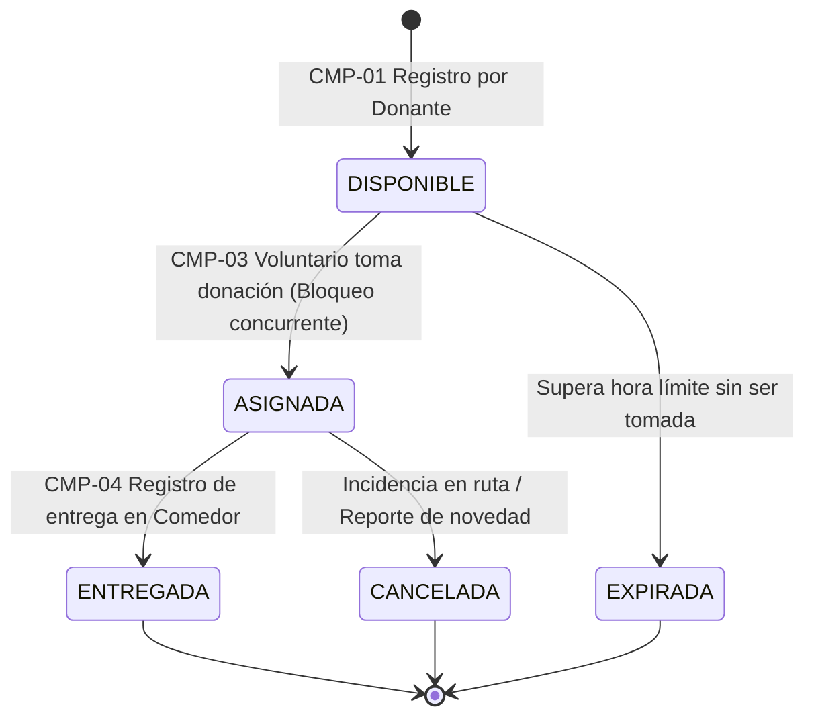

# Especificación de Comportamientos del MVP

**Proyecto:** Red de Rescate de Alimentos  
**Organización:** Fundación Mesa Común (Cali, Colombia)  
**Equipo:** Nexo Cívico Studio  
**Versión:** 1.0 — Módulo 3  

> [!NOTE]  
> Este documento describe el comportamiento esperado del sistema en tiempo presente. Constituye la fuente de verdad técnica contra la que se validan el código, las pruebas automatizadas y los incrementos en los Sprint Reviews.

---

## Modelo de Estados de una Donación

Toda donación en el ciclo de vida del MVP transita por el siguiente ciclo determinístico de estados:



---

## CMP-01 · Registro de Donación de Alimentos con Exención Sanitaria
- **Origen:** `RF-001` (Registro de donación) | `RF-017` (Inocuidad y ventana) | `RNF-001` (Formulario <3 pasos)
- **Actor:** Comerciante Donante / Administrador en plaza de mercado o restaurante.
- **Descripción:** El donante publica una oferta de alimentos aptos para consumo especificando los atributos mínimos para su recolección expedita.

### Criterios de Aceptación (Gherkin):
```gherkin
Escenario: CA-01.1 Publicación exitosa de donación con aceptación legal
  Dado que el comerciante ingresa al formulario de donación,
  Cuando registra tipo de alimento, cantidad estimada (en kg o canastillas), dirección de recogida y hora límite,
  Y marca la casilla obligatoria de exención de responsabilidad sanitaria bajo la Ley 1990 de 2019,
  Y presiona "Publicar Donación",
  Entonces el sistema crea la donación con estado "DISPONIBLE",
  Y genera un código único de seguimiento (ej. DON-101),
  Y registra la fecha y hora de creación.

Escenario: CA-01.2 Bloqueo de publicación sin exención legal
  Dado que el donante diligencia los datos de la oferta,
  Cuando intenta enviar el formulario sin aceptar la exención de responsabilidad de la Ley 1990 de 2019,
  Entonces el sistema impide el registro,
  Y muestra un mensaje de validación indicando la obligatoriedad de la aceptación legal.

Escenario: CA-01.3 Registro en entorno sin conexión (Offline)
  Dado que el donante se encuentra en una plaza de mercado sin señal celular,
  Cuando completa y envía el formulario de donación,
  Entonces el sistema almacena la donación localmente en el dispositivo (IndexedDB),
  Y muestra una confirmación visual de "Guardado localmente — pendiente de sincronización",
  Y la envía automáticamente al servidor en cuanto se reanuda la conexión a internet.
```

---

## CMP-02 · Visualización y Filtrado de Donaciones Disponibles
- **Origen:** `RF-002` (Consulta de estado) | `RF-014` (Capacidad de frío) | `RNF-001` (Mobile-First)
- **Actor:** Voluntario de transporte / Coordinadora Operativa (Diana).
- **Descripción:** Presenta el catálogo de ofertas activas en tiempo real, permitiendo identificar rápidamente ubicación, tipo de alimento y restricciones de refrigeración.

### Criterios de Aceptación (Gherkin):
```gherkin
Escenario: CA-02.1 Visualización de ofertas vigentes
  Dado que existen donaciones en estado "DISPONIBLE" cuya hora límite es posterior a la hora actual,
  Cuando un voluntario o coordinador abre el panel de donaciones,
  Entonces el sistema muestra únicamente las donaciones en estado "DISPONIBLE",
  Y oculta las donaciones expiradas o ya asignadas.

Escenario: CA-02.2 Identificación visual de alimentos con cadena de frío
  Dado que una donación contiene productos perecederos (lácteos, carnes, comidas preparadas),
  Cuando se muestra en la lista de ofertas,
  Entonces la tarjeta exhibe una etiqueta destacada "Requiere Refrigeración",
  Y muestra el tiempo restante exacto antes de que expire la ventana de recogida.
```

---

## CMP-03 · Toma de Donación con Bloqueo de Segunda Toma Concurrente (Reserva Única)
- **Origen:** `RF-004` (Coordinación de recogida) | `RF-010` (Exclusión de colisión) | `RNF-004` (Integridad transaccional)
- **Actor:** Voluntario de Transporte.
- **Descripción:** Permite a un voluntario asumir la responsabilidad de recolectar una donación disponible, asegurando mediante exclusión mutua que ningún otro voluntario pueda tomarla al mismo tiempo.

### Criterios de Aceptación (Gherkin):
```gherkin
Escenario: CA-03.1 Asignación exitosa a primer voluntario
  Dada una donación con estado "DISPONIBLE",
  Cuando el voluntario "Juan Pérez" selecciona la opción "Tomar Donación",
  Entonces el sistema actualiza de forma atómica el estado a "ASIGNADA",
  Y registra a "Juan Pérez" como responsable de la recogida,
  Y registra la fecha y marca de tiempo exacta de la asignación,
  Y despliega la dirección completa del donante y las instrucciones de ruta.

Escenario: CA-03.2 Bloqueo de segunda toma e información a quien llega tarde (Concurrencia)
  Dada una donación que acaba de ser asignada al voluntario "Juan Pérez",
  Cuando otro voluntario "Carlos Gómez" intenta presionar simultáneamente "Tomar Donación",
  Entonces el sistema rechaza la transacción de "Carlos Gómez",
  Y actualiza la interfaz mostrando una alerta clara: "Esta donación ya fue tomada por otro voluntario",
  Y remueve inmediatamente la donación del listado de disponibles de "Carlos Gómez".
```

---

## CMP-04 · Registro y Confirmación de Entrega a Organización Receptora
- **Origen:** `RF-005` (Registro de entrega) | `RF-006` (Trazabilidad y custodia)
- **Actor:** Voluntario de Transporte / Encargado de Comedor Comunitario.
- **Descripción:** Formaliza el cierre del traslado físico de los alimentos, documentando la recepción en el comedor comunitario y garantizando la cadena de custodia.

### Criterios de Aceptación (Gherkin):
```gherkin
Escenario: CA-04.1 Cierre de entrega exitosa
  Dada una donación en estado "ASIGNADA" asignada a un voluntario,
  Cuando el voluntario entrega físicamente los alimentos en el comedor "Comedor Comunitario Siloé",
  Y registra el nombre del receptor y la confirmación de llegada,
  Entonces el sistema actualiza el estado a "ENTREGADA",
  Y registra la marca temporal de entrega y el responsable de recepción,
  Y la donación pasa al histórico auditable de impacto.

Escenario: CA-04.2 Bloqueo de entrega de donación no asignada
  Dada una donación en estado "DISPONIBLE",
  Cuando se intenta registrar una entrega sin haber sido tomada previamente por un voluntario,
  Entonces el sistema bloquea la acción indicando que la donación debe ser tomada antes de entregarse.
```

---

## CMP-05 · Consulta y Trazabilidad del Historial de Donaciones
- **Origen:** `RF-002` (Consulta de estado) | `RF-006` (Línea de tiempo) | `RF-007` (Reportes)
- **Actor:** Coordinación General (Marcela Ocampo) / Auditor de Cooperantes.
- **Descripción:** Permite auditar en cualquier momento el historial íntegro de cualquier lote de alimentos rescatado desde su origen hasta su destino final.

### Criterios de Aceptación (Gherkin):
```gherkin
Escenario: CA-05.1 Trazabilidad completa de punta a punta
  Dada una donación registrada en el sistema con código "DON-101",
  Cuando cualquier coordinador consulta su detalle histórico,
  Entonces el sistema presenta la línea de tiempo completa:
    1. Donante emisor, tipo de alimento, cantidad y hora de registro.
    2. Voluntario asignado y hora en que tomó la donación.
    3. Organización receptora de destino, hora de entrega y receptor final.
```
