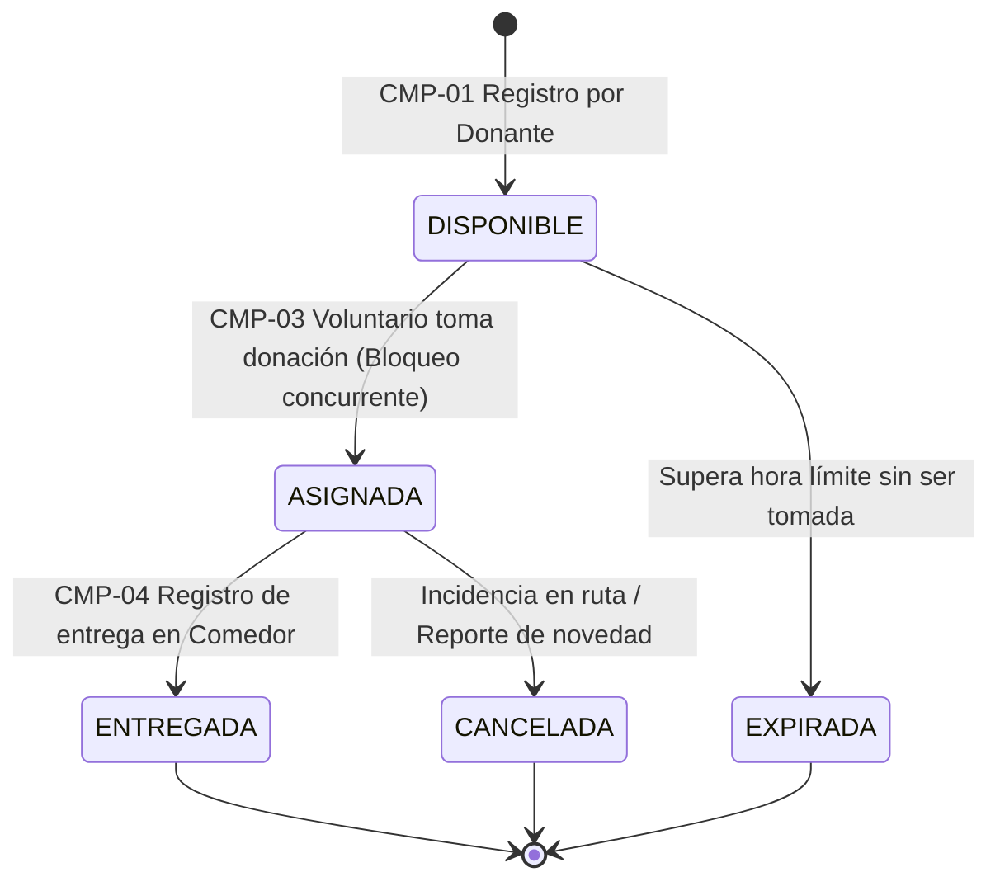

# Especificación de Comportamientos del MVP

**Proyecto:** Red de Rescate de Alimentos
**Organización:** Fundación Mesa Común (Cali, Colombia)
**Equipo:** Nexo Cívico Studio
**Versión:** 2.0 — Módulo 3
**Estado:** Aprobado / Fuente de Verdad Técnica para Tablero y Pruebas

> [!NOTE]
> Este documento describe el comportamiento esperado del sistema en **tiempo presente**. Constituye el contrato técnico ejecutable contra el que se implementan el código, las pruebas automatizadas y los incrementos en los Sprint Reviews. Cada comportamiento mapea a una historia de usuario y a los issues del tablero de GitHub Projects.

---

## Modelo de Estados Determinístico de una Donación

Toda donación en el ciclo de vida del MVP transita por el siguiente ciclo determinístico de estados:



---

## CMP-01 · Un comercio publica una donación

* **Historia (US1.1):** Como comerciante donante, quiero registrar una donación de alimentos con su tipo, cantidad, ventana de recogida y aceptación legal, para que los voluntarios y comedores comunitarios sepan qué hay disponible y cuándo recogerlo.
* **Comportamiento:** `CMP-01` en `comportamientos.md` · **Origen:** `RF-001` (Registro de donación) | `RF-017` (Inocuidad y ventana) | `RNF-001` (Mobile-First) | `RNF-002` (Offline-First)

### Criterios de Aceptación (Gherkin):

```gherkin
Escenario: CA-01.1 Publicación exitosa de oferta con aceptación legal y georreferenciación
  Dado un comercio o donante con sesión iniciada en la plataforma,
  Cuando registra tipo de alimento, cantidad estimada (kg/canastillas), ventana de tiempo,
  Y selecciona la zona urbana de Cali (CENTRO, NORTE, SUR, ORIENTE, LADERA),
  Y fija el punto de recogida mediante mapa interactivo OpenStreetMap o presets de plazas,
  Y opcionalmente detalla indicaciones del puesto/muelle y teléfono de contacto,
  Y marca la casilla obligatoria de exención de responsabilidad sanitaria bajo la Ley 1990 de 2019,
  Y presiona "Publicar Donación",
  Entonces la donación queda creada en estado "DISPONIBLE",
  Y genera un código único de seguimiento (ej. DON-101),
  Y se hace visible de forma inmediata en la lista de ofertas para los voluntarios con su posición geográfica.

Escenario: CA-01.2 Bloqueo por ventana de tiempo inválida (hora límite anterior o igual)
  Dada una ventana de recogida cuya hora límite es anterior o igual a la hora de publicación,
  Cuando el comercio intenta enviar el formulario,
  Entonces el sistema impide el registro,
  Y muestra un mensaje de validación indicando que la hora límite de recogida debe ser posterior a la hora actual.

Escenario: CA-01.3 Bloqueo por omisión de exención legal (Ley 1990 de 2019)
  Dado que el comerciante diligencia todos los datos del lote de alimentos,
  Cuando intenta presionar "Publicar Donación" sin marcar la casilla de exoneración legal sanitaria,
  Entonces el sistema deshabilita el envío,
  Y resalta la advertencia legal de obligatoriedad según la normativa colombiana.

Escenario: CA-01.4 Marcado de alimentos con requerimiento de refrigeración
  Dado que el lote contiene alimentos perecederos (lácteos, carnes, preparados calientes),
  Cuando el comercio marca la casilla "Requiere refrigeración",
  Entonces la donación queda registrada con el indicador requiereFrio = true,
  Y el sistema añade la etiqueta destacada visible para voluntarios y comedores con frío funcional.

Escenario: CA-01.5 Registro en entorno sin conexión móvil y sincronización reactiva (Offline-First)
  Dado que el donante se encuentra en una plaza de mercado (Santa Elena o Cavasa) sin señal celular 4G,
  Cuando completa y envía el formulario de donación,
  Entonces el sistema almacena la donación localmente en el dispositivo (IndexedDB / Dexie.js) con código temporal OFFLINE-DON-X,
  Y muestra una confirmación visual: "Guardado localmente — pendiente de sincronización",
  Y al reanudarse la conexión a Internet, el sistema procesa la cola automáticamente,
  Y actualiza de forma reactiva la interfaz del donante de OFFLINE-DON-X al código definitivo DON-XXX sin requerir recargar la página.
```

* **Se prueba como:** `comercio / donante` · `teléfono`

### Definición de Terminado (DoD Específico):

- [x] Cumple todos sus criterios de aceptación (`CA-01.1` a `CA-01.5`).
- [x] El código está revisado y aprobado por otro integrante (Peer review / QA).
- [x] Tiene pruebas automatizadas y todas pasan.
- [x] Está integrada en `main` sin romper la compilación (`npm run build` en verde).
- [x] La documentación afectada está actualizada en `docs/spec/`.
- [x] Pasan las dos pruebas de gobierno (cero datos inventados y consentimiento legal sin captura de datos sensibles).
- [x] Se probó entrando con el rol real de donante en dispositivo móvil (viewport celular).

---

## CMP-02 · Visualización y filtrado de donaciones disponibles

* **Historia (US2.1):** Como voluntario de transporte u organización receptora, quiero consultar las donaciones activas filtradas por cercanía geográfica y requerimiento de refrigeración, para identificar rápidamente qué alimentos puedo rescatar según mi capacidad instalada.
* **Comportamiento:** `CMP-02` en `comportamientos.md` · **Origen:** `RF-002` (Consulta de estado) | `RF-014` (Cadena de frío) | `RNF-001` (Mobile-First)

### Criterios de Aceptación (Gherkin):

```gherkin
Escenario: CA-02.1 Visualización reactiva de ofertas vigentes y excedentes en mapa
  Dado que existen donaciones en la base de datos con estado "DISPONIBLE" y ventana vigente,
  Cuando un voluntario o comedor receptor abre el catálogo móvil,
  Entonces el sistema muestra únicamente las donaciones en estado "DISPONIBLE",
  Y presenta para cada una: donante, tipo de alimento, cantidad en kg, zona de Cali y temporizador restante,
  Y ofrece la opción de desplegar el mapa interactivo OpenStreetMap (Leaflet),
  Proyectando cada excedente disponible como un marcador cartográfico con código, producto, peso y bandera de frío,
  Con fallback automático al centro de la zona de Cali si la oferta no incluyó GPS manual.

Escenario: CA-02.2 Identificación destacada de cadena de frío
  Dado que una oferta activa contiene alimentos con el indicador requiereFrio = true,
  Cuando se renderiza en la lista de ofertas,
  Entonces la tarjeta exhibe una etiqueta destacada visual "Requiere Refrigeración",
  Y restringe la asignación para que no sea canalizada a comedores sin nevera funcional.

Escenario: CA-02.3 Filtrado por zona geográfica de Cali y radar multivoluntario con fitBounds
  Dadas donaciones ubicadas en diferentes sectores ("NORTE", "CENTRO", "SUR", "ORIENTE", "LADERA"),
  Cuando el voluntario selecciona un filtro por zona específica,
  Entonces el catálogo filtra en el cliente de forma reactiva mostrando solo las ofertas del sector seleccionado,
  Y el mapa cartográfico OpenStreetMap centra su encuadre en el sector correspondiente,
  Permitiendo a su vez ciclar secuencialmente entre las unidades de transporte de la flota activa (Voluntario 1 -> Voluntario 2),
  O encuadrar a toda la flota en una panorámica colectiva de Cali mediante map.fitBounds(),
  Trazando polilíneas discontinuas diferenciadas por ruta (Ruta 1 verde esmeralda y Ruta 2 azul cielo).

Escenario: CA-02.4 Ocultamiento automático de donaciones expiradas
  Dada una donación cuya hora límite de recogida es superada en el reloj del sistema sin haber sido tomada,
  Cuando expira la ventana temporal,
  Entonces la donación transiciona internamente a estado "EXPIRADA",
  Y desaparece automáticamente del listado de donaciones disponibles sin requerir recarga manual.
```

* **Se prueba como:** `voluntario / comedor receptor` · `teléfono`

### Definición de Terminado (DoD Específico):

- [x] Cumple todos sus criterios de aceptación (`CA-02.1` a `CA-02.4`).
- [x] El código está revisado y aprobado por otro integrante (Peer review / QA).
- [x] Tiene pruebas automatizadas y todas pasan.
- [x] Está integrada en `main` sin romper la compilación.
- [x] La documentación afectada está actualizada en `docs/spec/`.
- [x] Pasan las dos pruebas de gobierno (tiempos y cantidades calculadas desde base de datos, sin cifras inventadas).
- [x] Se probó entrando con el rol real de voluntario/comedor en dispositivo móvil.

---

## CMP-03 · Toma de donación con bloqueo de segunda toma (Reserva Única)

* **Historia (US3.1):** Como voluntario de transporte u organización receptora, quiero reservar de manera exclusiva una donación disponible, para asegurar la recogida sin que otra persona u organización se desplace simultáneamente por la misma carga.
* **Comportamiento:** `CMP-03` en `comportamientos.md` · **Origen:** `RF-004` (Coordinación de recogida) | `RF-010` (Exclusión de colisión) | `RNF-004` (Integridad transaccional y concurrencia)

### Criterios de Aceptación (Gherkin):

```gherkin
Escenario: CA-03.1 Asignación exitosa e indivisible al primer solicitante
  Dada una donación en estado "DISPONIBLE",
  Cuando el voluntario "Juan Pérez" presiona la acción "Tomar Donación",
  Entonces el sistema ejecuta una transacción atómica actualizando el estado a "ASIGNADA",
  Y vincula a "Juan Pérez" como responsable único de la recogida,
  Y registra la fecha y marca temporal exacta (UTC) de la asignación,
  Y muestra en pantalla la dirección completa de recogida y los datos de contacto del donante.

Escenario: CA-03.2 Bloqueo atómico a segunda toma simultánea (Caso Borde Concurrente)
  Dada una donación que acaba de ser asignada al voluntario "Juan Pérez",
  Cuando otro voluntario "Carlos Gómez" intenta presionar en paralelo o milisegundos después "Tomar Donación",
  Entonces la base de datos detecta que el estado ya no es "DISPONIBLE" y rechaza la solicitud de "Carlos Gómez",
  Y el backend responde con un código HTTP 409 Conflict,
  Y la interfaz de "Carlos Gómez" muestra la notificación amigable: "Esta donación acaba de ser reservada por otra persona. Te mostramos las ofertas disponibles más cercanas.",
  Y remueve inmediatamente la tarjeta de la vista de "Carlos Gómez".

Escenario: CA-03.3 Bloqueo de toma sobre ofertas expiradas o canceladas
  Dada una donación que ha pasado a estado "EXPIRADA" o "CANCELADA",
  Cuando cualquier voluntario intenta enviar una petición de toma,
  Entonces el sistema deniega la operación,
  Y emite el mensaje de advertencia: "La oferta seleccionada ya no se encuentra vigente para recogida."
```

* **Se prueba como:** `voluntario de transporte` · `teléfono` (con prueba de concurrencia simulada)

### Definición de Terminado (DoD Específico):

- [x] Cumple todos sus criterios de aceptación (`CA-03.1` a `CA-03.3`).
- [x] El código está revisado y aprobado por otro integrante (Peer review / QA).
- [x] **Prueba de concurrencia verificada:** Se demostró mediante test automatizado o simulación concurrente que dos peticiones simultáneas nunca asignan la donación dos veces (el segundo intento recibe HTTP 409).
- [x] Está integrada en `main` sin romper la compilación.
- [x] La documentación afectada está actualizada en `docs/spec/`.
- [x] Pasan las dos pruebas de gobierno.
- [x] Se probó entrando con el rol real de voluntario en dispositivo móvil.

---

## CMP-04 · Registro y confirmación de entrega a organización receptora

* **Historia (US4.1):** Como voluntario de transporte o encargado de comedor comunitario, quiero registrar y confirmar la entrega física de los alimentos con fecha, hora y responsable de recepción, para garantizar el cierre formal de la custodia y el aprovechamiento de la donación.
* **Comportamiento:** `CMP-04` en `comportamientos.md` · **Origen:** `RF-005` (Registro de entrega) | `RF-006` (Trazabilidad y custodia)

### Criterios de Aceptación (Gherkin):

```gherkin
Escenario: CA-04.1 Cierre formal de entrega e inspección física en comedor comunitario
  Dada una donación en estado "ASIGNADA" asignada al voluntario en ruta,
  Cuando el voluntario arriba al comedor receptor "Comedor Siloé",
  Y la persona encargada de la cocina en el comedor inspecciona el estado de los alimentos (EXCELENTE, BUENO, REGULAR),
  Y diligencia su nombre completo institucional y observaciones y presiona "CONFIRMAR ENTREGA FÍSICA Y FIRMAR ACTA",
  Entonces el sistema transiciona la donación al estado definitivo "ENTREGADA",
  Y emite el acta digital inmutable con marca de tiempo UTC y código de auditoría,
  Y la donación pasa irreversiblemente al historial auditado de impacto.

Escenario: CA-04.2 Bloqueo defensivo de entrega de donación no asignada
  Dada una donación en estado "DISPONIBLE" que aún no ha sido tomada en el catálogo por ningún voluntario,
  Cuando se intenta ingresar a su URL de confirmación de entrega,
  Entonces el sistema bloquea defensivamente el formulario desplegando la advertencia "ENTREGA BLOQUEADA",
  E instruye al usuario a reservar la oferta previamente desde el catálogo de donaciones.

Escenario: CA-04.3 Anonimización de beneficiarios finales (Cumplimiento Ley 1581 de 2012)
  Dada la confirmación de entrega en el comedor comunitario,
  Cuando se consolida la información del acta digital,
  Entonces el sistema registra únicamente la institución receptora y la estimación agregada de raciones beneficiadas,
  Y garantiza que no se solicitan ni almacenan cédulas, documentos de identidad ni fotografías de comensales beneficiarios.
```

* **Se prueba como:** `voluntario / encargado de comedor` · `teléfono`

### Definición de Terminado (DoD Específico):

- [x] Cumple todos sus criterios de aceptación (`CA-04.1` a `CA-04.3`).
- [x] El código está revisado y aprobado por otro integrante (Peer review / QA).
- [x] Tiene pruebas automatizadas y todas pasan.
- [x] Está integrada en `main` sin romper la compilación.
- [x] La documentación afectada está actualizada en `docs/spec/`.
- [x] Pasan las dos pruebas de gobierno (comprobado que no se almacenan datos personales de comensales).
- [x] Se probó entrando con el rol real de voluntario/comedor en dispositivo móvil.

---

## CMP-05 · Consulta del estado y trazabilidad de una donación

* **Historia (US5.1):** Como coordinadora general (Marcela Ocampo) o donante, quiero consultar en cualquier momento la línea de tiempo y el estado actual de una donación mediante su código de seguimiento, para verificar la trazabilidad completa y generar soporte auditado para los cooperantes.
* **Comportamiento:** `CMP-05` en `comportamientos.md` · **Origen:** `RF-002` (Consulta de estado) | `RF-006` (Línea de tiempo) | `RF-007` (Reportes de impacto)

### Criterios de Aceptación (Gherkin):

```gherkin
Escenario: CA-05.1 Consulta de estado en tiempo real por código único
  Dada una donación registrada con código "DON-101",
  Cuando cualquier usuario con el código consulta su detalle,
  Entonces el sistema presenta su estado vigente ("DISPONIBLE", "ASIGNADA", "ENTREGADA", "EXPIRADA", "CANCELADA"),
  Y los datos públicos del lote (tipo de alimento, kilogramos y fecha de registro).

Escenario: CA-05.2 Línea de tiempo auditada de punta a punta
  Dada una donación que ha culminado su ciclo de rescate en estado "ENTREGADA",
  Cuando la coordinadora general consulta el historial detallado,
  Entonces el sistema exhibe la línea de tiempo inmutable con marcas de tiempo verificables:
    1. Registro: Donante emisor, cantidad en kg y fecha/hora de publicación.
    2. Asignación: Voluntario de transporte y fecha/hora en que tomó la donación.
    3. Cierre: Comedor comunitario receptor, fecha/hora de llegada y nombre del encargado de recepción.

Escenario: CA-05.3 Transparencia de métricas sin datos inventados (Prueba de Gobierno)
  Dada la visualización del acumulado de impacto institucional,
  Cuando la coordinadora consulta el total de kilogramos rescatados en el periodo,
  Entonces el sistema calcula el total estrictamente mediante la sumatoria de donaciones en estado "ENTREGADA",
  Y garantiza que ninguna cifra de impacto proviene de valores prefabricados o constantes sin origen en base de datos.
```

* **Se prueba como:** `coordinadora general` · `escritorio (computador)` / `donante` · `teléfono`

### Definición de Terminado (DoD Específico):

- [ ] Cumple todos sus criterios de aceptación (`CA-05.1` a `CA-05.3`).
- [ ] El código está revisado y aprobado por otro integrante (Peer review / QA).
- [ ] Tiene pruebas automatizadas y todas pasan.
- [ ] Está integrada en `main` sin romper la compilación.
- [ ] La documentación afectada está actualizada en `docs/spec/`.
- [ ] Pasan las dos pruebas de gobierno (cifras 100% calculadas desde registros reales).
- [ ] Se probó entrando con el rol real de coordinadora en dispositivo de escritorio.
