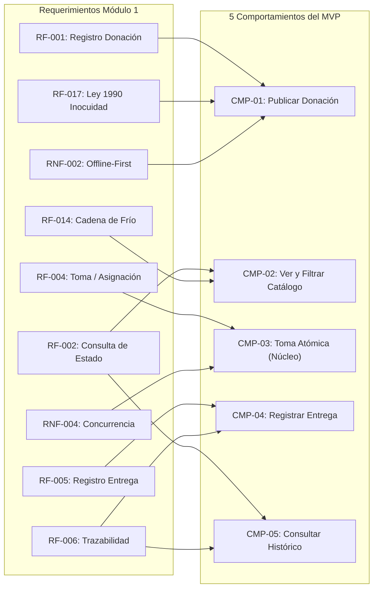
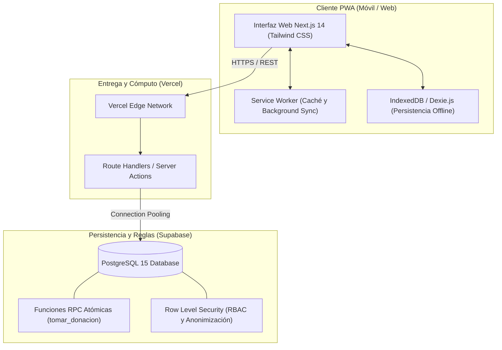

# Entrega 3A — Especificación y Plan de Proyecto

**Universidad Autónoma de Occidente (UAO) — Facultad de Ingeniería**
**Proyecto Informático 2 (Módulo 3) — Construcción Ágil del MVP**
**Docente:** César Augusto Navia Rojas
**Equipo:** Nexo Cívico Studio (Equipo 3)
**Slogan:** *«Software de bajo impacto operativo, alta eficiencia social»*
**Proyecto:** Red de Rescate de Alimentos (Cali, Colombia) — Caso: Fundación Mesa Común
**Alternativa Técnica Ganadora (Módulo 2):** Aplicación Web Progresiva (PWA) Serverless ($0.00 USD/mes de costo de infraestructura)
**Fecha Límite:** Miércoles 7 de octubre de 2026, 11:59 p. m. | **Peso:** 20% (Carácter Habilitante)

---

> [!NOTE]
> Este documento constituye la versión canónica en Markdown del documento oficial de entrega [`Entrega 3A - Especificación y Plan de Proyecto_ Nexo Rescate Alimentos.docx`](<file:///f:/01_Development/UAO/Proyecto_Informatico_2/nexo-rescate-alimentos/Entrega%203A%20-%20Especificacio%CC%81n%20y%20Plan%20de%20Proyecto_%20Nexo%20Rescate%20Alimentos.docx>). Integra la totalidad de la especificación técnica, la constitución del equipo, la definición de calidad (DoR/DoD), los 5 comportamientos en Gherkin, el plan técnico y el backlog de tareas atómicas para el tablero de GitHub Projects, cumpliendo rigurosamente con los criterios de **Nivel 5 de la Rúbrica de la UAO**.

---

## Portada: Conformación del Equipo y Roles Declarados

| Integrante | Rol Principal | Responsabilidad Principal y Artefactos Entregables |
| :--- | :--- | :--- |
| **Eduard Criollo Yule** | **Product Owner / Lead** | Visión del producto, priorización estricta del backlog en GitHub Projects, trazabilidad con requerimientos del Módulo 1 y articulación institucional con la Fundación Mesa Común. |
| **Alejandro Rodríguez Cortés** | **Full-Stack Developer** | Arquitectura frontend PWA (Next.js / Tailwind CSS), flujos móviles de publicación y catálogo, consumo de API Serverless e integración de clientes. |
| **Juan Sebastián Delgado** | **Backend / Database Engineer** | Modelado relacional PostgreSQL (Supabase), diseño de transacciones atómicas con bloqueo pesimista contra colisiones concurrentes y persistencia IndexedDB. |
| **Felipe Charria Caicedo** | **QA Engineer** | Estrategia de pruebas de aceptación BDD (Gherkin), diseño de suites de pruebas de estrés/concurrencia y verificación cruzada de DoR y DoD en Pull Requests. |
| **Juan Camilo Peña Sandoval** | **DevOps Engineer** | Automatización del pipeline de CI/CD en GitHub Actions, despliegue continuo en Vercel y monitoreo de cuotas de capa gratuita ($0 USD/mes). |
| **Santiago Valencia Sandoval** | **UX Designer** | Arquitectura de información móvil (<3 pasos por flujo), pruebas heurísticas de usabilidad para entornos de plazas de mercado y accesibilidad visual WCAG 2.1. |

> **Regla de Cobertura entre Pares:** Cada rol cuenta con respaldo directo. Si el responsable principal se ausenta, su par técnico asume el artefacto visible sin detener el flujo de construcción del sprint.

---

## 1. Habilitadores y Constitución del Proyecto

### 1.1. Entorno de Desarrollo y Habilitadores Técnicos

El entorno de desarrollo, versionamiento y gestión ágil del proyecto se encuentra totalmente operativo y con acceso de lectura activo para el cuerpo docente:

* **Repositorio Oficial en GitHub:** [`https://github.com/EduardCY/nexo-rescate-alimentos`](https://github.com/EduardCY/nexo-rescate-alimentos) configurado con ramas protegidas (`main`, `develop`, `spec`) y plantillas para Pull Requests e Issues.
* **Tablero de Gestión:** GitHub Projects con las cuatro columnas canónicas activas (`Por hacer`, `En curso`, `En revisión`, `Terminado`) y el Backlog de tareas atómicas cargado con estimaciones en horas y asignaciones individuales.
* **Entorno de Despliegue en la Nube:** Aplicación desplegada en Vercel ([`https://nexo-rescate-alimentos.vercel.app`](https://nexo-rescate-alimentos.vercel.app)) conectada a base de datos PostgreSQL 15 en Supabase, operando en capa gratuita sin costo recurrente ($0 USD/mes).
* **Permisos de Acceso:** El docente César Augusto Navia Rojas cuenta con acceso de lectura e inspección tanto al repositorio como al tablero.

### 1.2. Convenciones de Trabajo y Control de Versiones

El equipo aplica un flujo Git Flow simplificado. Toda integración a `main` requiere un Pull Request aprobado por un par técnico con rol distinto al autor. Los commits siguen la convención *Conventional Commits* en español:

* **Formato:** `<tipo>(<alcance>): <descripción imperativa en español> [#<ID_TAREA>]`
* **Tipos autorizados:** `feat` (nueva funcionalidad), `fix` (corrección), `docs` (especificación/documentación), `test` (pruebas automatizadas), `refactor` (reestructuración sin cambio de comportamiento), `chore` (configuración y dependencias).
* **Ejemplo:** `feat(concurrencia): implementar procedimiento atomico de bloqueo para segunda toma CMP-03 [#08]`

### 1.3. Política Ética y Declaración de Uso de Inteligencia Artificial

> [!IMPORTANT]
> **Lineamientos de IA del Equipo Nexo Cívico Studio:**
>
> 1. **Herramientas Autorizadas:** Antigravity IDE motorizado por **Gemini 3.8 Flash** (para velocidad de scaffolding, exploración de contexto y generación de esqueletos) y **Claude 4.6 Opus** (para razonamiento de consistencia arquitectónica, análisis de casos de borde de concurrencia y refactorización técnica).
> 2. **Alcance Permitido:** Generación de plantillas boilerplate de código, matrices de pruebas Gherkin y asistencia en redacción de especificaciones.
> 3. **Alcance Prohibido:** Integración a ciegas de código no leído, alucinaciones sin tipado estricto o sustitución del análisis técnico del equipo.
> 4. **Sustentación Individual Obligatoria en Sprint Review:** En cada sesión a partir de la Sesión 10, cualquier integrante llamado por el docente debe explicar línea por línea cualquier función construida. Responder *«lo generó la IA»* constituye reprobación inmediata del incremento.
> 5. **Consenso del Equipo sobre Commits:** Debido a disponibilidad de herramientas de IA estudiantil, los commits en Git se centralizan en los integrantes autorizados, pero **todo incremento es auditado y defendido por el equipo en mesa conjunta**, mitigando el antecedente de fallos en asignaturas previas.

---

### 1.4. Definiciones de Calidad: DoR y DoD

#### Definición de Listo (Definition of Ready - DoR)

*Gobierna la entrada de una historia o tarea a la columna **«Por hacer»** en el tablero. Solo ingresa si cumple la totalidad de estos puntos:*

##### Base Obligatoria del Módulo:

- [ ] **Está escrita como historia de usuario:** Estructurada en formato canónico (*Como [rol], quiero [acción], para [beneficio]*).
- [ ] **Tiene criterios de aceptación en Gherkin:** Formulados con la estructura (*Dado [contexto] ... cuando [evento] ... entonces [resultado]*).
- [ ] **Se traza a un requerimiento del Módulo 1 y a un comportamiento:** Enlazada a su código de origen (`RF`/`RNF`) y a su comportamiento (`CMP`).
- [ ] **Está estimada por el equipo:** Estimación acordada en horas de sesión individual (≤ 3 a 4 horas).
- [ ] **Sus dependencias están identificadas y ninguna la bloquea:** Prerrequisitos resueltos y disponibles.
- [ ] **Es lo bastante pequeña para terminarse dentro de un sprint:** Tarea atómica y manejable.

##### Criterios Propios del Proyecto Nexo Cívico Studio (Justificados):

- [ ] **Si muestra una cifra, dice de qué dato sale:**
  > *Por qué:* En este proyecto aparecieron cuatro veces valores inventados que se veían como métricas reales. Una cifra sin origen declarado no se puede probar, y lo que no se puede probar arriesga los reportes financieros que se entregan a cooperantes internacionales (Fundación Carvajal / Fondo Internacional).
  >
- [ ] **Si guarda datos de una persona, dice cuáles, para qué y con qué autorización:**
  > *Por qué:* De los beneficiarios finales en comedores no se guarda ningún dato personal ni biométrico, únicamente raciones agregadas. Cumplimiento de `RNF-003` y la Ley 1581 de 2012 (Habeas Data). Decidirlo al redactar la historia evita costosas migraciones de datos en producción.
  >
- [ ] **Dice con qué rol se prueba y en qué dispositivo (teléfono o escritorio):**
  > *Por qué:* Nexo Rescate Alimentos cuenta con cuatro roles; comerciantes, voluntarios y comedores operan desde teléfono móvil en campo, mientras que la coordinación opera desde escritorio. Una historia que no lo especifica se prueba erróneamente en el entorno que menos se parece a la operación real.
  >
- [ ] **Compuerta de Inocuidad y Validación de Cadena de Frío:**
  > *Por qué:* La Fundación Mesa Común tiene el antecedente crítico de perder más de 200 kg de tomate por asignar alimentos perecederos sin verificar la refrigeración funcional del comedor. Toda historia de donación debe incorporar la exención legal (Ley 1990 de 2019) y el indicador booleano `requiereFrio`.
  >
- [ ] **Definición de estrategia Offline-First y persistencia local:**
  > *Por qué:* En plazas de mercado como Cavasa y Santa Elena la señal celular 4G es intermitente o nula (`RNF-002`). La historia debe definir qué se almacena localmente en IndexedDB y qué se sincroniza al recuperar red.
  >

---

#### Definición de Terminado (Definition of Done - DoD)

*Gobierna la transición de una tarea desde **«En revisión»** hacia **«Terminado»** en el tablero:*

##### Base Obligatoria del Módulo:

- [ ] **Cumple todos sus criterios de aceptación:** Escenarios Gherkin verificados punto por punto.
- [ ] **El código está revisado y aprobado por otro integrante:** Revisión de pares obligatoria (PR aprobado por par/QA).
- [ ] **Tiene pruebas automatizadas y todas pasan:** Pruebas unitarias/integración en verde y sin errores de compilación (`npm run build`).
- [ ] **Está integrada en `main` sin romper la compilación:** Código limpio sin conflictos en la rama principal.
- [ ] **La documentación afectada está actualizada:** Contratos de API y especificaciones actualizados en `docs/spec/`.
- [ ] **Si se utilizó IA, alguien la revisó y la explica:** El responsable auditó cada línea y está capacitado para defenderla en Sprint Review.

##### Criterios Propios del Proyecto Nexo Cívico Studio (Justificados):

- [ ] **Pasan las dos pruebas de gobierno:**
  1. *Prueba de Cifras Reales:* Se comprueba que ninguna métrica de impacto, peso o beneficiario utilice datos inventados o valores *hardcoded*.
  2. *Prueba de Autorización y Privacidad:* Se valida que no se almacenen nombres, fotos ni documentos de personas beneficiarias en comedores (Ley 1581 de 2012).
- [ ] **Se probó entrando con el rol real y en el dispositivo real correspondiente:** Verificación en teléfono móvil (viewport celular) para campo o escritorio para administración.
- [ ] **Verificación de Bloqueo Concurrente Atómico en Toma de Donaciones (Reserva Única - `CMP-03`):** Se demuestra que dos usuarios en paralelo no pueden tomar la misma donación al mismo tiempo (el segundo recibe HTTP 409 y mensaje claro).
- [ ] **Garantía de Cero Costo Recurrente en Capas Gratuitas ($0.00 USD/mes / Free Tier Guardrail):** Se valida que no introduce servicios pagos ni desborda cuotas de almacenamiento de Supabase/Vercel, protegiendo la caja menor de $150.000 COP/mes (`RNF-005`).

---

## 2. Especificación del MVP y su Trazabilidad

### 2.1. Alcance y Matriz de Trazabilidad entre Requerimientos (Módulo 1) y el Núcleo del MVP

El MVP resuelve de punta a punta el problema central del caso de estudio. Alineado con la guía oficial, se descartan características secundarias que no agregan dificultad técnica ni aprendizaje en las semanas disponibles (gestión avanzada de usuarios, notificaciones push de terceros y paneles con datos simulados).



| Requerimiento de Origen                       | Comportamiento del MVP                                            | Alcance y Garantía Técnica                                                                                                                                     |
| :-------------------------------------------- | :---------------------------------------------------------------- | :--------------------------------------------------------------------------------------------------------------------------------------------------------------- |
| **RF-001 / RF-017 / RNF-001 / RNF-002** | **`CMP-01` · Un comercio publica una donación**         | Registro rápido (<3 pasos), ventana de tiempo, exención sanitaria obligatoria (Ley 1990 de 2019) y persistencia offline en IndexedDB.                          |
| **RF-002 / RF-014 / RNF-001**           | **`CMP-02` · Visualización y filtrado de donaciones**   | Catálogo reactivo en tiempo real, etiqueta visual destacada de cadena de frío y restricción para comedores sin nevera funcional.                              |
| **RF-004 / RF-010 / RNF-004**           | **`CMP-03` · Toma de donación con bloqueo concurrente** | Reserva única atómica (**El corazón del MVP**). Bloqueo pesimista a segundos voluntarios y respuesta controlada HTTP 409 Conflict.                      |
| **RF-005 / RF-006 / RNF-003**           | **`CMP-04` · Registro de entrega en comedor receptor**   | Cierre formal de custodia física, acta digital con nombre de receptor y anonimización estricta de beneficiarios (Ley 1581).                                    |
| **RF-002 / RF-006 / RF-007**            | **`CMP-05` · Consulta de estado y trazabilidad**         | Auditoría en línea de tiempo (Donante$\rightarrow$ Voluntario $\rightarrow$ Comedor) y cálculo de métricas reales para cooperantes sin datos inventados. |

---

### 2.2. Especificación Detallada de los 5 Comportamientos del MVP (BDD / Gherkin)

#### CMP-01 · Un comercio publica una donación

* **Historia de Usuario (US1.1):** Como comerciante donante, quiero registrar una donación de alimentos con su tipo, cantidad, ventana de recogida y aceptación legal, para que los voluntarios y comedores comunitarios sepan qué hay disponible y cuándo recogerlo.
* **Trazabilidad:** `RF-001` (Registro) | `RF-017` (Ventana e Inocuidad) | `RNF-001` (Mobile-First) | `RNF-002` (Offline)
* **Se prueba como:** `comercio / donante` · `teléfono móvil`
* **Criterios de Aceptación (Gherkin):**

```gherkin
Escenario: CA-01.1 Publicación exitosa de oferta con aceptación legal
  Dado un comercio con sesión iniciada en la plataforma,
  Cuando registra tipo de alimento, cantidad (kg), dirección y ventana de recogida,
  Y marca la casilla obligatoria de exención sanitaria bajo la Ley 1990 de 2019,
  Y presiona "Publicar Donación",
  Entonces la donación queda en estado DISPONIBLE con código DON-XXX,
  Y aparece inmediatamente en el catálogo de los voluntarios.

Escenario: CA-01.2 Bloqueo por ventana de tiempo inválida (hora límite anterior o igual)
  Dada una ventana cuya hora límite es anterior o igual a la hora de publicación,
  Cuando el comercio intenta enviar el formulario,
  Entonces el sistema rechaza la publicación y notifica que la hora límite debe ser posterior.

Escenario: CA-01.3 Bloqueo por omisión de exención legal (Ley 1990 de 2019)
  Dado que el comerciante diligencia los datos pero omite la casilla de exención legal,
  Cuando intenta presionar "Publicar Donación",
  Entonces el sistema impide el envío y resalta la obligatoriedad legal.

Escenario: CA-01.4 Marcado de alimentos con requerimiento de refrigeración
  Dado que el lote contiene productos perecederos (lácteos, carnes, preparados),
  Cuando el comercio marca "Requiere refrigeración",
  Entonces la donación queda con requiereFrio = true y etiqueta visual destacada.

Escenario: CA-01.5 Registro en entorno sin conexión móvil (Offline-First)
  Dado que el comercio se encuentra sin señal 4G en la plaza de mercado,
  Cuando envía el formulario,
  Entonces el sistema almacena la donación localmente en IndexedDB,
  Y la sincroniza de forma automática en cuanto se reanuda la conexión a Internet.
```

---

#### CMP-02 · Visualización y filtrado de donaciones disponibles

* **Historia de Usuario (US2.1):** Como voluntario de transporte u organización receptora, quiero consultar las donaciones activas filtradas por cercanía geográfica y requerimiento de refrigeración, para identificar rápidamente qué alimentos puedo rescatar según mi capacidad instalada.
* **Trazabilidad:** `RF-002` (Consulta de estado) | `RF-014` (Cadena de frío) | `RNF-001` (Mobile-First)
* **Se prueba como:** `voluntario / comedor receptor` · `teléfono móvil`
* **Criterios de Aceptación (Gherkin):**

```gherkin
Escenario: CA-02.1 Visualización reactiva de ofertas vigentes
  Dado que existen donaciones en estado DISPONIBLE con ventana vigente,
  Cuando un voluntario abre el catálogo móvil,
  Entonces el sistema muestra únicamente las ofertas disponibles ordenadas por cercanía y urgencia.

Escenario: CA-02.2 Identificación destacada de cadena de frío
  Dado que una oferta activa contiene alimentos con requiereFrio = true,
  Cuando se renderiza en la lista de ofertas,
  Entonces exhibe la etiqueta destacada "Requiere Refrigeración" y el temporizador antes de expirar.

Escenario: CA-02.3 Filtrado por capacidad de frío del comedor
  Dado un comedor comunitario sin refrigeración funcional (tieneRefrigeracion = false),
  Cuando consulta las donaciones,
  Entonces el sistema advierte o deshabilita la reserva de lotes perecederos.

Escenario: CA-02.4 Ocultamiento automático de donaciones expiradas
  Dada una donación cuya hora límite ya pasó sin ser tomada por un voluntario,
  Cuando expira la ventana temporal,
  Entonces desaparece automáticamente de la vista pública y transiciona a EXPIRADA.
```

---

#### CMP-03 · Toma de donación con bloqueo de segunda toma (Reserva Única)

* **Historia de Usuario (US3.1):** Como voluntario de transporte u organización receptora, quiero reservar de manera exclusiva una donación disponible, para asegurar la recogida sin que otra persona u organización se desplace simultáneamente por la misma carga.
* **Trazabilidad:** `RF-004` (Coordinación de recogida) | `RF-010` (Exclusión de colisión) | `RNF-004` (Integridad y concurrencia)
* **Se prueba como:** `voluntario de transporte` · `teléfono móvil` *(prueba de concurrencia simulada)*
* **Criterios de Aceptación (Gherkin):**

```gherkin
Escenario: CA-03.1 Asignación exitosa e indivisible al primer solicitante
  Dada una donación en estado DISPONIBLE,
  Cuando el voluntario A selecciona "Tomar Donación",
  Entonces la transacción atómica actualiza el estado a ASIGNADA, vincula al voluntario A y despliega la ruta de recogida.

Escenario: CA-03.2 Bloqueo atómico a segunda toma simultánea (Caso Borde Concurrente)
  Dada una donación que acaba de ser asignada al voluntario A,
  Cuando el voluntario B intenta presionar "Tomar Donación" en paralelo,
  Entonces la base de datos detecta que no está DISPONIBLE, rechaza la solicitud con HTTP 409 Conflict,
  Y muestra la notificación amigable: "Esta donación acaba de ser reservada por otra persona. Te mostramos las ofertas disponibles más cercanas."

Escenario: CA-03.3 Remoción reactiva ante conflicto
  Dada la respuesta de conflicto HTTP 409 en la interfaz del voluntario B,
  Cuando se procesa el rechazo,
  Entonces la donación se remueve reactivamente de su lista sin necesidad de recargar la página.

Escenario: CA-03.4 Bloqueo de toma sobre ofertas expiradas o canceladas
  Dada una donación que ha pasado a estado EXPIRADA o CANCELADA,
  Cuando cualquier voluntario intenta tomarla,
  Entonces el sistema bloquea la acción indicando que la oferta ya no se encuentra vigente.
```

---

#### CMP-04 · Registro y confirmación de entrega a organización receptora

* **Historia de Usuario (US4.1):** Como voluntario de transporte o encargado de comedor comunitario, quiero registrar y confirmar la entrega física de los alimentos con fecha, hora y responsable de recepción, para garantizar el cierre formal de la custodia y el aprovechamiento de la donación.
* **Trazabilidad:** `RF-005` (Registro de entrega) | `RF-006` (Trazabilidad y custodia) | `RNF-003` (Habeas Data)
* **Se prueba como:** `voluntario / encargado de comedor` · `teléfono móvil`
* **Criterios de Aceptación (Gherkin):**

```gherkin
Escenario: CA-04.1 Cierre formal de entrega en comedor comunitario
  Dada una donación en estado ASIGNADA,
  Cuando el voluntario arriba al comedor receptor y diligencia el nombre del encargado receptor,
  Entonces el sistema actualiza el estado a ENTREGADA, registra la marca de tiempo UTC y cierra el ciclo de custodia.

Escenario: CA-04.2 Bloqueo de entrega de donación no asignada
  Dada una donación en estado DISPONIBLE que no ha sido tomada por un voluntario,
  Cuando se intenta registrar una confirmación de entrega directa,
  Entonces el sistema bloquea la acción indicando que la donación debe ser tomada formalmente antes de entregarse.

Escenario: CA-04.3 Anonimización de beneficiarios finales (Ley 1581)
  Dada la confirmación digital de entrega,
  Cuando se guarda el registro en el sistema,
  Entonces se valida que no se recolecten nombres ni datos personales de personas beneficiarias, guardando únicamente raciones agregadas.
```

---

#### CMP-05 · Consulta del estado y trazabilidad de una donación

* **Historia de Usuario (US5.1):** Como coordinadora general (Marcela Ocampo) o donante, quiero consultar en cualquier momento la línea de tiempo y el estado actual de una donación mediante su código de seguimiento, para verificar la trazabilidad completa y generar soporte auditado para los cooperantes.
* **Trazabilidad:** `RF-002` (Consulta de estado) | `RF-006` (Línea de tiempo) | `RF-007` (Reportes de impacto)
* **Se prueba como:** `coordinadora general` · `escritorio (computador)` / `donante` · `teléfono móvil`
* **Criterios de Aceptación (Gherkin):**

```gherkin
Escenario: CA-05.1 Consulta de estado en tiempo real por código único
  Dada una donación registrada con código DON-101,
  Cuando cualquier usuario autorizado ingresa el código,
  Entonces el sistema retorna su estado vigente (DISPONIBLE, ASIGNADA, ENTREGADA, EXPIRADA o CANCELADA) y datos públicos del lote.

Escenario: CA-05.2 Línea de tiempo auditada de punta a punta
  Dada una donación en estado ENTREGADA,
  Cuando la coordinadora consulta su historial detallado,
  Entonces el sistema presenta la línea de tiempo completa: fecha/hora de publicación, voluntario asignado y entrega final en comedor con el receptor.

Escenario: CA-05.3 Transparencia de métricas sin datos inventados (Prueba de Gobierno)
  Dada la visualización del acumulado de impacto institucional,
  Cuando la coordinadora consulta los kilogramos rescatados,
  Entonces el sistema calcula el total estrictamente mediante la sumatoria de donaciones entregadas, garantizando que ninguna cifra provenga de datos inventados.
```

---

### 2.3. Resolución de Casos Borde: Bloqueo Concurrente de la Segunda Toma (El Corazón del MVP)

El problema neurálgico del caso de estudio —que colapsó la coordinación operativa por WhatsApp— es la duplicidad de voluntarios dirigiéndose al mismo tiempo por la misma carga. El sistema erradica esta condición de carrera aplicando control de concurrencia determinístico en la capa de persistencia:

```sql
-- Procedimiento Transaccional Atómico en PostgreSQL (Supabase RPC)
CREATE OR REPLACE FUNCTION tomar_donacion(
    p_donacion_id UUID,
    p_voluntario_id UUID
)
RETURNS JSONB AS $$
DECLARE
    v_filas_afectadas INT;
BEGIN
    -- Actualización atómica condicionada al estado DISPONIBLE
    UPDATE donaciones
    SET estado = 'ASIGNADA',
        voluntario_id = p_voluntario_id,
        asignada_at = NOW()
    WHERE id = p_donacion_id
      AND estado = 'DISPONIBLE';

    GET DIAGNOSTICS v_filas_afectadas = ROW_COUNT;

    IF v_filas_afectadas = 1 THEN
        -- Éxito para el primer voluntario
        RETURN jsonb_build_object(
            'exito', true,
            'mensaje', 'Donación asignada correctamente.'
        );
    ELSE
        -- Conflicto para el segundo voluntario (código HTTP 409)
        RETURN jsonb_build_object(
            'exito', false,
            'codigo', 409,
            'mensaje', 'Esta donación acaba de ser reservada por otra persona. Te mostramos las ofertas disponibles más cercanas.'
        );
    END IF;
END;
$$ LANGUAGE plpgsql;
```

---

## 3. Plan Técnico Coherente con la Alternativa del Módulo 2

### 3.1. Arquitectura del Sistema y Fundamentación de la PWA Serverless

En el Módulo 2, la **Alternativa A (PWA Serverless)** obtuvo la calificación más alta del grupo (**4.68 / 5.0**) frente a la Aplicación Nativa (2.85) y al Agente de WhatsApp (2.38):

1. **Presupuesto Cero ($0.00 USD/mes):** El cliente cuenta con un presupuesto máximo de $150.000 COP/mes (`RNF-005`) reservado para gasolina y refrigerios. La arquitectura se despliega en los *Free Tiers* de Vercel y Supabase.
2. **Sostenibilidad sin Administrador de Servidores:** Arquitectura Serverless sin servidores VPS Linux dedicados.
3. **Resiliencia Offline-First:** IndexedDB (Dexie.js) y Service Workers para operar sin señal en plazas como Cavasa y Santa Elena.
4. **Cero Fricción de Instalación:** Operable desde cualquier navegador móvil sin descargas de tiendas de apps.



---

### 3.2. Modelo de Datos Relacional (PostgreSQL)

* **`ORGANIZACION`:** `id` (UUID PK), `nombre`, `tipo` (`DONANTE`, `RECEPTOR`, `FUNDACION`), `direccion`, `zona` (`NORTE`, `CENTRO`, `SUR`, `ORIENTE`, `LADERA`), `tiene_refrigeracion` (BOOLEAN), `capacidad_raciones_dia` (INT).
* **`USUARIO`:** `id` (UUID PK), `nombre`, `email`, `rol` (`COORDINADOR`, `VOLUNTARIO`, `DONANTE`, `RECEPTOR`), `telefono`, `vehiculo_tipo` (`MOTO`, `CARROMOTO`, `CARRO`, `BICICLETA`, `A_PIE`), `disponible` (BOOLEAN).
* **`DONACION`:** `id` (UUID PK), `codigo` (`DON-XXX`), `donante_id` (FK), `tipo_alimento`, `requiere_frio` (BOOLEAN), `cantidad_estimada`, `unidad_medida`, `direccion_recogida`, `hora_limite`, `estado` (`DISPONIBLE`, `ASIGNADA`, `ENTREGADA`, `EXPIRADA`, `CANCELADA`), `voluntario_id` (FK nullable), `comedor_id` (FK nullable), `exencion_aceptada` (BOOLEAN), `created_at`, `asignada_at`, `entregada_at`.
* **`TRAZABILIDAD_EVENTO`:** `id` (UUID PK), `donacion_id` (FK), `estado_anterior`, `estado_nuevo`, `usuario_id` (FK), `timestamp`, `observaciones`.

---

### 3.3. Matriz de Conversión de Riesgos del Módulo 2 a Decisiones Técnicas y Backlog

| Riesgo Identificado (Módulo 2)                                                | Decisión Técnica Concreta en el Plan                                                                             | Tarea Asociada en el Backlog                                         |
| :----------------------------------------------------------------------------- | :----------------------------------------------------------------------------------------------------------------- | :------------------------------------------------------------------- |
| **Desalojo de memoria local (Storage Eviction) en PWA móvil.**          | Uso de IndexedDB con esquema liviano y purga automática de fotografías de donaciones tras 30 días (`RF-018`). | `TASK-05`: Persistencia offline con Dexie.js y control de cuotas.  |
| **Doble asignación de donación por alta concurrencia de voluntarios.** | Transacciones atómicas con bloqueo pesimista en PostgreSQL y código HTTP 409 Conflict.                           | `TASK-08`: Procedimiento atómico de reserva y modal de conflicto. |
| **Falla crítica de cobertura 4G en plazas Cavasa y Santa Elena.**       | Service Workers para caché de interfaz y Background Sync para encolar publicaciones salientes sin red.            | `TASK-05`: Sincronización automática al detectar red.            |
| **Riesgo de superar capa gratuita y generar costos a la fundación.**    | Arquitectura Serverless optimizada, code-splitting y compresión de activos en el cliente.                         | `TASK-15`: Monitoreo de cuotas Free Tier y pipelines de CI.        |
| **Temor de donantes frente a demandas por intoxicación.**               | Casilla obligatoria con acta digital de exención de responsabilidad bajo la Ley 1990 de 2019.                     | `TASK-04`: Formulario legal obligatorio antes del despacho.        |

---

## 4. Backlog de Tareas Atómicas, Priorizado y Asignado

Cada tarea atómica apunta a un único criterio de aceptación Gherkin y puede ser terminada por una sola persona en una sesión individual de trabajo (≤ 4 horas). La priorización se defiende con el alcance del MVP: las primeras tareas construyen el flujo vertical núcleo de punta a punta (End-to-End Core Walkthrough) en el Sprint 1:

| ID Tarea | Descripción Atómica (≤ 4 horas) | Criterio Asociado | Responsable | Rol | Prioridad | Est. |
| :--- | :--- | :--- | :--- | :--- | :--- | :---: |
| **`TASK-01`** | Configurar DDL en PostgreSQL y tipos TypeScript (Donación, Usuario, Reserva). | Transversal | Juan Sebastián Delgado | Backend | Alta (P1) | 3h |
| **`TASK-02`** | Diseñar formulario Mobile-First de donación con selector y fecha/hora límite. | `CA-01.1` | Santiago Valencia Sandoval | UX Designer | Alta (P1) | 3h |
| **`TASK-03`** | Implementar validaciones en cliente para ventana de recogida y horas pasadas. | `CA-01.2 / CA-01.3` | Alejandro Rodríguez | Full-Stack | Alta (P1) | 3h |
| **`TASK-04`** | Integrar casilla obligatoria de exención legal Ley 1990 y flag `requiereFrio`. | `CA-01.4` | Alejandro Rodríguez | Full-Stack | Alta (P1) | 2h |
| **`TASK-05`** | Configurar persistencia offline con IndexedDB para plazas sin señal 4G. | `CA-01.5` | Juan Sebastián Delgado | Backend | Alta (P1) | 4h |
| **`TASK-06`** | Construir catálogo reactivo de donaciones disponibles con filtros por sector. | `CA-02.1 / CA-02.3` | Alejandro Rodríguez | Full-Stack | Alta (P1) | 3h |
| **`TASK-07`** | Implementar etiqueta destacada de cadena de frío y filtro para comedores sin nevera. | `CA-02.2` | Santiago Valencia Sandoval | UX Designer | Alta (P1) | 2h |
| **`TASK-08`** | Desarrollar procedimiento atómico SQL con UPDATE condicional para toma única. | `CA-03.1` | Juan Sebastián Delgado | Backend | Alta (P1) | 4h |
| **`TASK-09`** | Implementar respuesta HTTP 409 y modal amigable ante colisión de toma concurrente. | `CA-03.2 / CA-03.3` | Alejandro Rodríguez | Full-Stack | Alta (P1) | 3h |
| **`TASK-10`** | Diseñar y ejecutar suite de pruebas automatizadas de concurrencia para CMP-03. | `CA-03.2 (QA)` | Felipe Charria | QA Engineer | Alta (P1) | 4h |
| **`TASK-11`** | Construir flujo móvil de confirmación de entrega física en comedor con receptor. | `CA-04.1 / CA-04.2` | Alejandro Rodríguez | Full-Stack | Alta (P1) | 3h |
| **`TASK-12`** | Auditar y verificar no almacenamiento de datos personales de comensales (Ley 1581). | `CA-04.3 (Habeas Data)` | Felipe Charria | QA Engineer | Alta (P1) | 2h |
| **`TASK-13`** | Implementar pantalla de consulta pública y línea de tiempo por código DON-XXX. | `CA-05.1 / CA-05.2` | Santiago Valencia Sandoval | UX Designer | Alta (P1) | 3h |
| **`TASK-14`** | Construir agregador de métricas reales de kilos rescatados sin datos inventados. | `CA-05.3 (Gobierno)` | Eduard Criollo | Product Owner | Alta (P1) | 3h |
| **`TASK-15`** | Configurar pipeline CI en GitHub Actions y monitoreo de límites Free Tier. | `RNF-005 (DevOps)` | Juan Camilo Peña | DevOps | Alta (P1) | 4h |

---

## 5. Enlaces a los Habilitadores Técnicos

1. **Repositorio Oficial en GitHub:**[`https://github.com/EduardCY/nexo-rescate-alimentos`](https://github.com/EduardCY/nexo-rescate-alimentos)*(Incluye ramas de trabajo `main`, `develop` y `spec`, constitución del proyecto en [`docs/spec/constitucion.md`](docs/spec/constitucion.md), comportamientos en [`docs/spec/comportamientos.md`](docs/spec/comportamientos.md) y plan técnico en [`docs/spec/plan-tecnico.md`](docs/spec/plan-tecnico.md)).*
2. **Tablero de Gestión del Proyecto (GitHub Projects):**[`https://github.com/users/EduardCY/projects/1`](https://github.com/users/EduardCY/projects/1)*(Configurado con las cuatro columnas normativas: Por hacer, En curso, En revisión, Terminado, y las 15 tareas atómicas del Sprint 1 cargadas con estimación en horas y responsable asignado).*
3. **Entorno de Demostración Desplegado en la Nube:**[`https://nexo-rescate-alimentos.vercel.app`](https://nexo-rescate-alimentos.vercel.app)*(Despliegue serverless continuo sobre Vercel Edge conectado a base de datos PostgreSQL en Supabase, operando en capa $0 USD/mes).*
4. **Acceso de Inspección Docente:**
   El profesor César Augusto Navia Rojas ha sido invitado formalmente al repositorio y al tablero con permisos de lectura y revisión.
