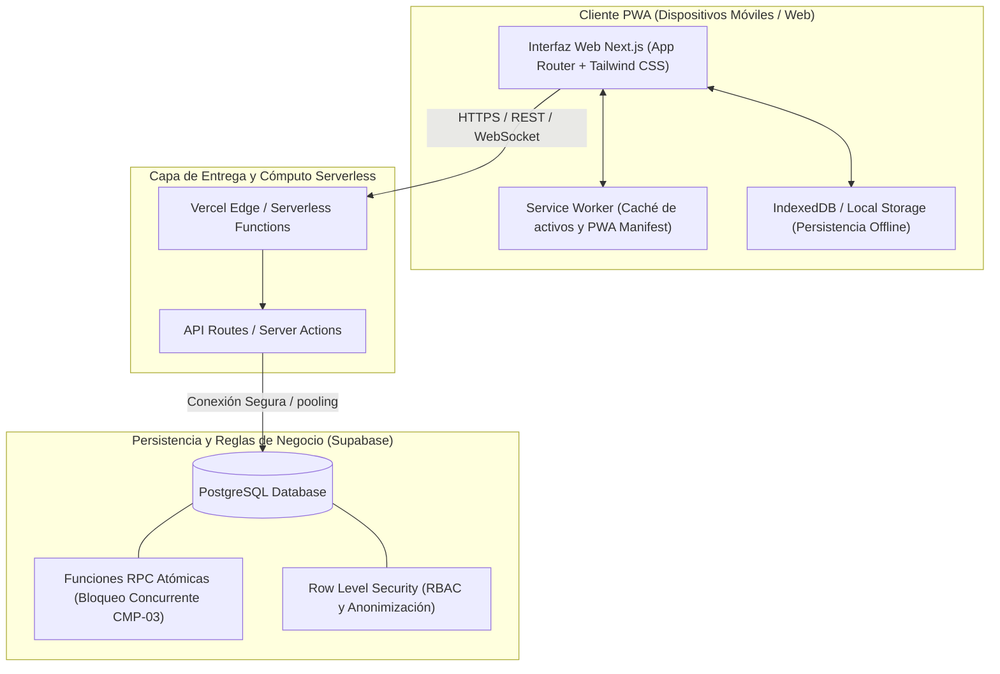

# Plan Técnico de la Solución

**Proyecto:** Red de Rescate de Alimentos  
**Organización:** Fundación Mesa Común  
**Equipo:** Nexo Cívico Studio  
**Alternativa Seleccionada:** Alternativa A — Aplicación Web Progresiva (PWA) Serverless  

---

## 1. Alternativa Seleccionada y Fundamentación

En la evaluación cuantitativa y cualitativa del Módulo 2, la **Alternativa A (PWA Serverless)** obtuvo la calificación más alta del grupo (**4.68 / 5.0**, 159/170 puntos) frente a la Aplicación Móvil Nativa (2.85 / 5.0) y al Agente de WhatsApp con IA (2.38 / 5.0).

### Razones Técnicas y Operativas de la Elección:
1. **Presupuesto Cero ($0 USD/mes):** El cliente cuenta con un presupuesto máximo de $150.000 COP/mes (RNF-005) reservado para caja menor. La arquitectura se apoya en los Free Tiers de Vercel y Supabase.
2. **Sostenibilidad sin Personal Técnico:** No requiere mantenimiento ni administración de servidores Linux dedicados (VPS).
3. **Resiliencia Offline-First:** En las plazas de mercado de Cali (Santa Elena, Cavasa, Caicedo), la señal celular es deficiente; la PWA utiliza Service Workers e IndexedDB para capturar registros sin red y sincronizarlos automáticamente al recuperar señal.
4. **Barrera de Fricción Mínima:** No exige a los voluntarios ni a los comerciantes descargar aplicaciones de 50 MB desde tiendas de aplicaciones (Play Store / App Store).

---

## 2. Arquitectura del Sistema

---

## 3. Modelo de Datos (Esquema Conceptual Relacional)

### Entidades Principales:
1. **`organizaciones`**: Entidades donantes, comedores y fundación central.
   - `id`, `nombre`, `tipo` (DONANTE, RECEPTOR, FUNDACION), `direccion`, `zona`, `telefono`, `tiene_refrigeracion` (BOOLEAN), `capacidad_raciones_dia`.
2. **`usuarios`**: Administradores del sistema, coordinadoras, voluntarios, donantes y receptores.
   - `id`, `nombre`, `email`, `rol` (`ADMIN`, `COORDINADOR`, `VOLUNTARIO`, `DONANTE`, `RECEPTOR`), `estado_cuenta` (`ACTIVO`, `SUSPENDIDO`, `PENDIENTE_AUTORIZACION`), `permisos_granulares` (JSONB), `telefono`, `vehiculo_tipo`, `disponible`.
3. **`donaciones`**: Núcleo transaccional del sistema.
   - `id`, `codigo` (ej. `DON-101`), `idempotency_key` (UUID v4 único para reconciliación offline sin colisiones), `codigo_origen_offline` (VARCHAR nullable, preserva el código determinista `OFFLINE-DON-<YYMMDD>-<DEV4>-<SEQ3>-<ENT4>`), `donante_id` (FK), `donante_nombre`, `tipo_alimento`, `requiere_frio` (BOOLEAN — `true`: *"Requiere Refrigeración"*, `false`: *"Temperatura Ambiente"*), `cantidad_estimada`, `unidad_medida` (kg, bultos, canastillas, unidades), `direccion_recogida`, `indicaciones_puesto`, `telefono_donante`, `coordenadas` (JSONB / CoordenadaGeo: lat, lng), `zona` (NORTE, CENTRO, SUR, ORIENTE, LADERA), `hora_limite`, `estado` (DISPONIBLE, ASIGNADA, ENTREGADA, EXPIRADA, CANCELADA), `voluntario_id` (FK nullable), `voluntario_nombre`, `comedor_id` (FK nullable), `comedor_nombre`, `exencion_sanitaria_aceptada` (BOOLEAN — Ley 1990/2019, Res. 2674/2013 INVIMA y Ley 1581/2012), `created_at`, `asignada_at`, `entregada_at`, `updated_at`.
4. **`trazabilidad_eventos`** y **`audit_rbac_eventos`**: Auditoría inmutable de cada transición logística y de administración de permisos.
   - `trazabilidad_eventos`: `id`, `donacion_id` (FK), `estado_anterior`, `estado_nuevo`, `usuario_id` (FK), `usuario_nombre`, `timestamp`, `observaciones`.
   - `audit_rbac_eventos`: `id`, `admin_id`, `usuario_afectado_id`, `accion` (`CREAR`, `EDITAR_ROL`, `SUSPENDER`, `REACTIVAR`), `rol_anterior`, `rol_nuevo`, `motivo`, `timestamp`.
5. **Almacenamiento Local Estructurado en Cliente (IndexedDB / Dexie.js v2 — `CMP-PWA` y `CMP-05`)**:
   - `donaciones_offline`: `id`, `codigoLocal` (`OFFLINE-DON-<YYMMDD>-<DEV4>-<SEQ3>-<ENT4>`), `idempotencyKey`, `datos` (`DonacionInput`), `timestamp`, `syncStatus` (`pending`, `synced`, `error`).
   - `outbox_mutations`: Cola general de mutaciones offline (`CREATE_DONACION`, `TAKE_DONACION`, `CONFIRM_ENTREGA`) con `idempotencyKey`, `payload`, `syncStatus`, `retryCount`, `lastError` e inspector visual de auditoría.
   - `catalogo_productos` y `donaciones_cache`: Catálogo local de productos y donaciones con sincronización delta (`updated_at > last_sync_timestamp`) para consulta y filtrado sin red.
   - `sesion_rbac`: Persistencia de sesión offline (`userId`, `rol`, `permisos`, `estadoCuenta`, `issuedAt`, `expiresAt`, `signatureHash` HMAC-SHA256) para garantizar que el confinamiento RBAC se cumpla aun sin conexión.

### Módulos y Helpers Clave del Frontend/Backend (`CMP-01` a `CMP-05` y `CMP-PWA`):
- **Validación y Reglas Puras:** `src/lib/validations/donacion.ts` (con soporte para coordenadas, puesto, teléfono y exención sanitaria obligatoria), `src/lib/validations/entrega.ts`, `src/lib/utils/donaciones-helper.ts` (`filtrarDonacionesDisponibles`, `evaluarVigenciaDonacion`, `normalizarFechaHoraLimite`, `inferirZonaCali`), `src/lib/utils/offline-code.ts` (generador determinista `OFFLINE-DON-<YYMMDD>-<DEV4>-<SEQ3>-<ENT4>`) y `src/lib/nexo/impact.ts` (`scoreMatch` con restricción de cadena de frío `CA-02.2`, `calcularDistanciaKm` con fórmula de Haversine).
- **Georreferenciación y Cartografía OpenStreetMap (\$0 USD/mes):** `src/components/donaciones/LocationPickerMap.tsx` (selector dinámico con Leaflet, pin arrastrable, presets de plazas de Cali y geolocalización GPS) y `src/components/nexo/RadarMap.tsx` (radar logístico con soporte multivoluntario, encuadre panorámico `fitBounds` y proyección de excedentes disponibles).
- **Arquitectura PWA Offline-First Estricta (`CMP-PWA` / `RNF-002`):** `public/sw.js` (Service Worker con App Shell Pre-caching, `Cache-First` para estáticos, `Stale-While-Revalidate` para vistas HTML/RSC y fallback a `/~offline`), `src/lib/pwa/register-sw.ts`, `src/lib/db.ts` (Dexie.js v2), `src/lib/sync/offline-sync.ts` y `src/components/nexo/OutboxInspectorModal.tsx`.
- **RBAC Corporativo, Trazabilidad e Impacto Real (`CMP-05`):** `src/lib/rbac/permisos.ts`, `src/lib/auth/offline-session.ts`, `src/middleware.ts` (confinamiento estricto del rol `VOLUNTARIO`), `src/app/admin/usuarios/page.tsx` (exclusivo para `ADMIN`), `src/app/rastreo/page.tsx` (`TimelineTracker.tsx`) y `src/actions/metricas.ts` (`obtenerMetricasImpactoReal` con Cero Datos Inventados en `/impacto`).

---

## 3.1. Arquitectura y Escalabilidad Geográfica (Urbano Cali -> Intermunicipal / Regional)

El modelo cartográfico y de ruteo (`src/types/index.ts`, `src/lib/nexo/impact.ts`, `src/lib/nexo/api.ts`) opera con coordenadas geográficas decimales WGS84 (`CoordenadaGeo`: `lat`, `lng`) y clasifica las operaciones bajo el tipo `AlcanceLogistico`:
1. **`URBANO` (Alcance Actual del MVP):** Cubre las 5 zonas de Santiago de Cali (`NORTE`, `CENTRO`, `SUR`, `ORIENTE`, `LADERA`), enlazando plazas tradicionales (Santa Elena, Alameda) con comedores comunitarios vulnerables (Siloé, Aguablanca).
2. **`METROPOLITANO` / `INTERMUNICIPAL` (Escalabilidad Futura Post-5 Comportamientos):** Permite incorporar nodos de abastecimiento mayorista agropecuario fuera del casco urbano (ej. Cavasa en Candelaria, Yumbo, Jamundí, Palmira, Buga, Tuluá) sin requerir reescritura de modelos, calculando distancias con la función matemática pura de Haversine (`calcularDistanciaKm`) y encuadres multicapa en OpenStreetMap.

---

## 4. Estrategia de Bloqueo de Concurrencia (CMP-03 / El Corazón del MVP)

Para evitar la doble toma de donaciones (dos voluntarios yendo por la misma donación), la asignación no se realiza mediante un `UPDATE` ingenuo en el cliente. Se ejecuta a través de una función transaccional atómica en PostgreSQL con bloqueo optimista/pesimista:

La implementación vigente vive en `supabase/migrations/20261028000000_task08_tomar_donacion_endurecida.sql` (reemplaza a la versión inicial de `20261009000000_init_schema.sql`). Firma: `tomar_donacion(p_donacion_id UUID, p_voluntario_id UUID, p_voluntario_nombre VARCHAR(255)) RETURNS JSONB`, `SECURITY DEFINER` con `search_path` fijo y `EXECUTE` solo para `anon`, `authenticated` y `service_role`.

Flujo: valida parámetros y quien toma → `SELECT ... FOR UPDATE` sobre la fila → evalúa estado → evalúa hora límite → `UPDATE` a `ASIGNADA` + `INSERT` en `trazabilidad_eventos`, todo en una sola transacción.

| `codigo` | Significado | Mensaje / criterio |
|---|---|---|
| `200` | Asignación exitosa (incluye `direccion_recogida`, `donante_nombre`, `donante_telefono`, `asignada_at`) | `CA-03.1` |
| `400` | Parámetros nulos | — |
| `403` | El usuario es `DONANTE` | — |
| `404` | Donación o voluntario inexistentes | — |
| `409` | La donación ya no está `DISPONIBLE` (ya tomada o entregada) | `CA-03.2` |
| `410` | Oferta `EXPIRADA`, `CANCELADA` o con hora límite vencida | `CA-03.3` |

Verificación: `tests/db/tomar-donacion.test.ts` (PostgreSQL real, ver cabecera del archivo) y `tests/integration/concurrency-lock.test.ts` incluyen la prueba de concurrencia del DoD de `CMP-03`.

---

## 5. Entorno, Despliegue y Ciclo de Vida del Servicio ($0 USD/mes)

- **Entorno Local:** Node.js 20+, Next.js dev server (`npm run dev`) en puerto 3000.
- **Variables de Entorno Requeridas (`.env.example` y `.env.local`):**
  - `NEXT_PUBLIC_SUPABASE_URL`
  - `NEXT_PUBLIC_SUPABASE_ANON_KEY`
  - `SUPABASE_SERVICE_ROLE_KEY`
  - `SUPABASE_DB_PASSWORD` (gestión interna)
  - `NEXT_PUBLIC_APP_URL`
  - `NEXT_PUBLIC_APP_NAME`
- **Entorno en Producción (Vercel Live):**
  - **Dominio Canónico Oficial:** [https://nexo-rescate-alimentos.vercel.app](https://nexo-rescate-alimentos.vercel.app)
  - **Rutas Operativas y Portales Especializados por Rol:**
    - Autenticación y Registro Diferenciado por Rol (`DONANTE`, `VOLUNTARIO`, `RECEPTOR`, `COORDINADOR`, `ADMIN`): `/login`
    - Portal y Dashboard SCADA Adaptativo por Rol (5 Experiencias Independientes con 0 Datos Mock): `/`
    - Publicación con OpenStreetMap y Offline-First (`CMP-01`): `/donar`
    - Catálogo reactivo, Pestaña de Donaciones Expiradas (`ADMIN`/`COORDINADOR`) y Radar Multivoluntario (`CMP-02`, `CMP-03`): `/donaciones`
    - Hoja de ruta móvil con navegación GPS (`CMP-03`): `/ruta-activa`
    - Acta digital de entrega en comedor comunitario (`CMP-04`): `/entregas/[id]`
    - Consulta pública de estado y línea de tiempo inmutable (`CMP-05`): `/rastreo`
    - Panel de impacto real auditado y exportación CSV (`CMP-05` — roles `COORDINADOR` / `ADMIN`): `/impacto`
    - Módulo de administración corporativa de usuarios y permisos RBAC (`CMP-05` — exclusivo rol `ADMIN`): `/admin/usuarios`
    - Vista de respaldo del App Shell Offline (`CMP-PWA` / `TRANSVERSAL`): `/~offline`
- **Despliegue Continuo (CI/CD) y Vercel CLI:**
  - Repositorio en GitHub enlazado a Vercel con validación previa en GitHub Actions (`.github/workflows/ci.yml`).
  - Despliegue directo a producción mediante CLI: `npx vercel deploy --prod --yes` (utilizado para superar incidencias de importación git del portal).

### 5.1. Políticas de Disponibilidad y Ciclo de Vida (Free Tier)
1. **Vercel (Hosting Serverless):**
   - **Disponibilidad:** 24/7/365 continua. El frontend y los Server Actions escalan a cero bajo inactividad para garantizar $0.00 USD de facturación.
   - **Procedimiento de Desactivación:** Vercel Dashboard → Proyecto → *Settings* → *Advanced* → *Pause Project* (para suspensión temporal) o *Delete Project* (para remoción total).
2. **Supabase (Base de Datos PostgreSQL 15):**
   - **Disponibilidad y Auto-Pausa:** Los proyectos en Free Tier entran en estado de **pausa automática tras 7 días consecutivos sin tráfico** a la API o base de datos.
   - **Procedimiento de Restauración:** Ingresar a [https://supabase.com/dashboard](https://supabase.com/dashboard) y presionar *"Restore project"*; se restablece en ~60 a 90 segundos con esquemas y datos íntegros.
   - **Procedimiento de Apagado Definitivo:** *Project Settings* → *General* → *Pause Project* / *Delete Project*.
