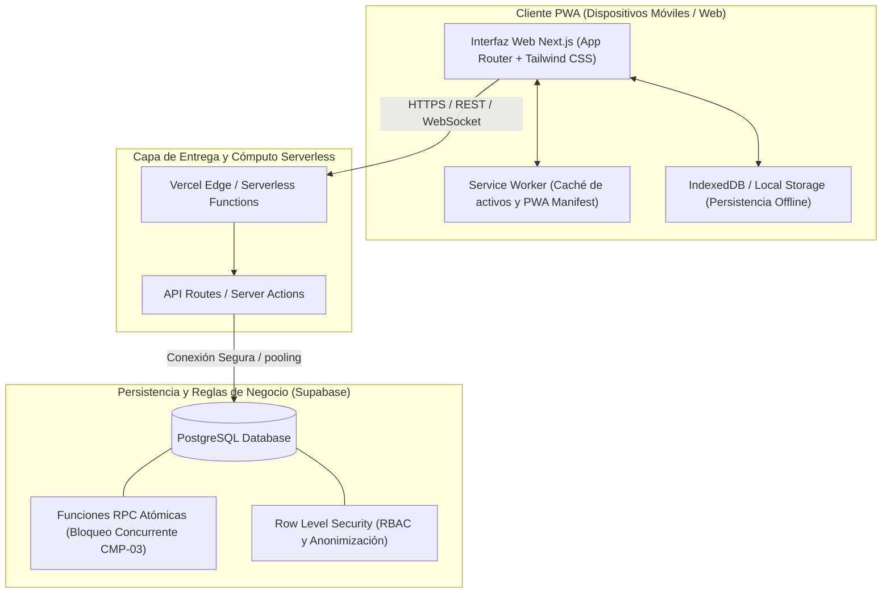

# Plan Técnico de la Solución

**Proyecto:** Red de Rescate de Alimentos  
**Organización:** Fundación Mesa Común  
**Equipo:** Nexo Cívico Studio  
**Alternativa Seleccionada:** Alternativa A — Aplicación Web Progresiva (PWA) Serverless  

---

## 1. Alternativa Seleccionada y Fundamentación

En la evaluación cuantitativa y cualitativa del Módulo 2, la **Alternativa A (PWA Serverless)** obtuvo la calificación más alta del grupo (**4.68 / 5.0**, 159/170 puntos) frente a la Aplicación Móvil Nativa (2.85 / 5.0) y al Agente de WhatsApp con IA (2.38 / 5.0).

### Razones Técnicas y Operativas de la Elección:
1. **Presupuesto Cero ($0 USD/mes):** El cliente cuenta con un presupuesto máximo de $150.000 COP/mes (RNF-005) reservado para caja menor. La arquitectura se apoya en los Free Tiers de Vercel y Supabase.
2. **Sostenibilidad sin Personal Técnico:** No requiere mantenimiento ni administración de servidores Linux dedicados (VPS).
3. **Resiliencia Offline-First:** En las plazas de mercado de Cali (Santa Elena, Cavasa, Caicedo), la señal celular es deficiente; la PWA utiliza Service Workers e IndexedDB para capturar registros sin red y sincronizarlos automáticamente al recuperar señal.
4. **Barrera de Fricción Mínima:** No exige a los voluntarios ni a los comerciantes descargar aplicaciones de 50 MB desde tiendas de aplicaciones (Play Store / App Store).

---

## 2. Arquitectura del Sistema

---

## 3. Modelo de Datos (Esquema Conceptual Relacional)

### Entidades Principales:
1. **`organizaciones`**: Entidades donantes, comedores y fundación central.
   - `id`, `nombre`, `tipo` (DONANTE, RECEPTOR, FUNDACION), `direccion`, `zona`, `telefono`, `tiene_refrigeracion` (BOOLEAN), `capacidad_raciones_dia`.
2. **`usuarios`**: Donantes, voluntarios, coordinadoras.
   - `id`, `nombre`, `email`, `rol` (COORDINADOR, VOLUNTARIO, DONANTE, RECEPTOR), `telefono`, `vehiculo_tipo`, `disponible`.
3. **`donaciones`**: Núcleo transaccional del sistema.
   - `id`, `codigo` (ej. DON-101), `donante_id` (FK), `tipo_alimento`, `requiere_frio` (BOOLEAN), `cantidad_estimada`, `unidad_medida` (kg, bultos, canastillas), `direccion_recogida`, `hora_limite`, `estado` (DISPONIBLE, ASIGNADA, ENTREGADA, EXPIRADA, CANCELADA), `voluntario_id` (FK nullable), `comedor_id` (FK nullable), `exencion_sanitaria_aceptada` (BOOLEAN), `created_at`, `asignada_at`, `entregada_at`.
4. **`trazabilidad_eventos`**: Auditoría inmutable de cada transición.
   - `id`, `donacion_id` (FK), `estado_anterior`, `estado_nuevo`, `usuario_id` (FK), `timestamp`, `observaciones`.

---

## 4. Estrategia de Bloqueo de Concurrencia (CMP-03 / El Corazón del MVP)

Para evitar la doble toma de donaciones (dos voluntarios yendo por la misma donación), la asignación no se realiza mediante un `UPDATE` ingenuo en el cliente. Se ejecuta a través de una función transaccional atómica en PostgreSQL con bloqueo optimista/pesimista:

La implementación vigente vive en `supabase/migrations/20261028000000_task08_tomar_donacion_endurecida.sql` (reemplaza a la versión inicial de `20261009000000_init_schema.sql`). Firma: `tomar_donacion(p_donacion_id UUID, p_voluntario_id UUID, p_voluntario_nombre VARCHAR(255)) RETURNS JSONB`, `SECURITY DEFINER` con `search_path` fijo y `EXECUTE` solo para `anon`, `authenticated` y `service_role`.

Flujo: valida parámetros y quien toma → `SELECT ... FOR UPDATE` sobre la fila → evalúa estado → evalúa hora límite → `UPDATE` a `ASIGNADA` + `INSERT` en `trazabilidad_eventos`, todo en una sola transacción.

| `codigo` | Significado | Mensaje / criterio |
|---|---|---|
| `200` | Asignación exitosa (incluye `direccion_recogida`, `donante_nombre`, `donante_telefono`, `asignada_at`) | `CA-03.1` |
| `400` | Parámetros nulos | — |
| `403` | El usuario es `DONANTE` | — |
| `404` | Donación o voluntario inexistentes | — |
| `409` | La donación ya no está `DISPONIBLE` (ya tomada o entregada) | `CA-03.2` |
| `410` | Oferta `EXPIRADA`, `CANCELADA` o con hora límite vencida | `CA-03.3` |

Verificación: `tests/db/tomar-donacion.test.ts` (PostgreSQL real, ver cabecera del archivo) incluye la prueba de concurrencia del DoD de `CMP-03`.

---

## 5. Entorno y Despliegue

- **Entorno Local:** Node.js 20+, Next.js dev server (`npm run dev`) en puerto 3000.
- **Variables de Entorno Requeridas (`.env.example`):**
  - `NEXT_PUBLIC_SUPABASE_URL`
  - `NEXT_PUBLIC_SUPABASE_ANON_KEY`
  - `SUPABASE_SERVICE_ROLE_KEY`
- **Despliegue Continuo (CI/CD):**
  - Repositorio en GitHub enlazado a Vercel con despliegues automáticos por cada push a `main` y vistas previas en cada Pull Request.
