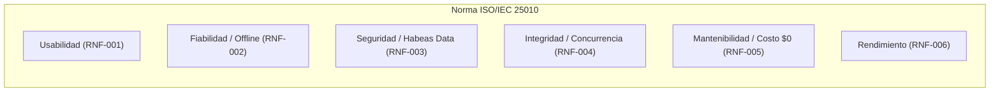

# Especificación de Requisitos del Sistema (SRS)

**Proyecto:** Red de Rescate de Alimentos  
**Organización:** Fundación Mesa Común (Cali, Colombia)  
**Equipo de Desarrollo:** Nexo Cívico Studio  
**Versión:** 1.0 — Módulo 3  
**Estado:** Aprobado / Fuente de Verdad Técnica  

---

## 1. Introducción y Contexto del Proyecto

El proyecto **Red de Rescate de Alimentos** es una plataforma web progresiva (PWA) diseñada para optimizar la logística de recolección y redistribución de alimentos aptos para consumo humano en Cali, articulando a:
1. **Comerciantes y donantes:** Plazas de mercado (Santa Elena, Cavasa, Alameda, Porvenir), restaurantes y grandes superficies.
2. **Voluntarios de transporte:** Red ciudadana de transporte solidario (motos, bicicletas, vehículos particulares).
3. **Organizaciones receptoras:** Comedores comunitarios y fundaciones asistenciales en zonas vulnerables (Siloé, Terrón Colorado, Distrito de Aguablanca).
4. **Fundación Mesa Común:** Equipo directivo y de coordinación operativa (Marcela Ocampo y Diana) encargado del seguimiento, la inocuidad y la rendición de cuentas ante cooperantes internacionales.

Este documento formaliza los **Requisitos Funcionales (RF)** y **Requisitos No Funcionales (RNF)** del sistema, alineados estrictamente con el marco legal colombiano (Ley 1990 de 2019 de donación de alimentos y Ley 1581 de 2012 de Habeas Data), el estándar de calidad **ISO/IEC 25010**, y la especificación de comportamientos ejecutables en Gherkin ([`comportamientos.md`](file:///f:/01_Development/UAO/Proyecto_Informatico_2/nexo-rescate-alimentos/docs/spec/comportamientos.md)).

---

## 2. Matriz de Requisitos Funcionales (RF)

Los requisitos funcionales se priorizan mediante la metodología **MoSCoW** (*Must Have*, *Should Have*, *Could Have*, *Won't Have*) diferenciando el alcance crítico del **MVP (Módulo 3)** frente a las fases evolutivas de la solución.

| ID | Nombre | Descripción Técnica | Prioridad | Comportamiento / Mapeo Técnico | Criterio de Aceptación Clave |
| :--- | :--- | :--- | :--- | :--- | :--- |
| **RF-001** | Registro Express de Donación | El sistema debe permitir a un donante autenticado o registrado publicar una oferta de alimentos indicando tipo de alimento, cantidad estimada, unidad de medida, dirección de recogida y hora límite de recolección. | **Must Have (MVP)** | [`CMP-01`](file:///f:/01_Development/UAO/Proyecto_Informatico_2/nexo-rescate-alimentos/docs/spec/comportamientos.md#L31-L59) | Formulario operable en menos de 3 pasos (<45s) con generación inmediata del código único `DON-XXX`. |
| **RF-002** | Consulta de Estado y Catálogo | El sistema debe exponer el estado en tiempo real de cada donación a lo largo de su ciclo de vida (`DISPONIBLE`, `ASIGNADA`, `ENTREGADA`, `EXPIRADA`, `CANCELADA`), ocultando automáticamente aquellas expiradas o finalizadas del tablero público. | **Must Have (MVP)** | [`CMP-02`](file:///f:/01_Development/UAO/Proyecto_Informatico_2/nexo-rescate-alimentos/docs/spec/comportamientos.md#L63-L82), [`CMP-05`](file:///f:/01_Development/UAO/Proyecto_Informatico_2/nexo-rescate-alimentos/docs/spec/comportamientos.md#L133-L148) | La lista de donaciones disponibles se actualiza reactivamente; el estado cambia de forma sincronizada para todos los usuarios. |
| **RF-003** | Gestión de Voluntarios y Disponibilidad | El sistema debe permitir registrar y conmutar el estado de disponibilidad operativa de los voluntarios de transporte (`disponible = true/false`), así como su medio de transporte (moto, bicicleta, carro, a pie). | **Must Have (MVP)** | [`plan-tecnico.md`](file:///f:/01_Development/UAO/Proyecto_Informatico_2/nexo-rescate-alimentos/docs/spec/plan-tecnico.md#L59-L61) | El voluntario puede activar o pausar su disponibilidad con un solo interruptor en su perfil móvil. |
| **RF-004** | Toma de Donación con Reserva Única | El sistema debe permitir a un voluntario disponible asumir la recogida de una donación en estado `DISPONIBLE`, garantizando exclusión mutua para impedir que dos voluntarios tomen la misma oferta de forma simultánea. | **Must Have (MVP)** | [`CMP-03`](file:///f:/01_Development/UAO/Proyecto_Informatico_2/nexo-rescate-alimentos/docs/spec/comportamientos.md#L85-L107) | Transacción atómica que bloquea la fila a nivel de base de datos; si otro usuario intenta tomarla, recibe mensaje de rechazo inmediato. |
| **RF-005** | Confirmación y Cierre de Entrega | El sistema debe permitir al voluntario asignado registrar la entrega física de los alimentos en el comedor comunitario de destino, registrando el nombre del receptor, fecha/hora y observaciones. | **Must Have (MVP)** | [`CMP-04`](file:///f:/01_Development/UAO/Proyecto_Informatico_2/nexo-rescate-alimentos/docs/spec/comportamientos.md#L110-L130) | La donación pasa irreversiblemente a estado `ENTREGADA` y no permite nuevas modificaciones en su asignación. |
| **RF-006** | Trazabilidad y Cadena de Custodia | El sistema debe registrar un historial inmutable de auditoría para cada donación, consignando cada cambio de estado, marca temporal precisa (UTC), usuario responsable y geolocalización o sede asociada. | **Must Have (MVP)** | [`CMP-05`](file:///f:/01_Development/UAO/Proyecto_Informatico_2/nexo-rescate-alimentos/docs/spec/comportamientos.md#L133-L148) | Visualización en línea de tiempo (registro -> asignación -> entrega) sin posibilidad de alteración histórica. |
| **RF-007** | Consolidación de Reportes para Cooperantes | El sistema debe calcular y consolidar periódicamente métricas clave de impacto: total de kilogramos rescatados, raciones estimadas entregadas, donaciones efectivas y comedores abastecidos. | **Must Have (MVP)** | [`plan-tecnico.md`](file:///f:/01_Development/UAO/Proyecto_Informatico_2/nexo-rescate-alimentos/docs/spec/plan-tecnico.md#L115-L120) | Generación de vista de métricas agregadas exportables con filtros por rango de fechas (mensual, trimestral). |
| **RF-008** | Consulta de Histórico Auditado | El sistema debe permitir a las coordinadoras (Marcela y Diana) consultar donaciones de periodos anteriores mediante filtros por donante, comedor, rango de fechas y estado. | **Should Have (Fase 2)** | [`CMP-05`](file:///f:/01_Development/UAO/Proyecto_Informatico_2/nexo-rescate-alimentos/docs/spec/comportamientos.md#L133-L148) | Búsqueda histórica con paginación y descarga en formato estructurado (CSV/JSON). |
| **RF-009** | Directorio Centralizado de Actores | El sistema debe mantener el registro y perfiles de donantes, comedores comunitarios y voluntarios, con sus datos de contacto, zonas geográficas de Cali y características operativas. | **Must Have (MVP)** | [`types/index.ts`](file:///f:/01_Development/UAO/Proyecto_Informatico_2/nexo-rescate-alimentos/src/types/index.ts#L19-L38) | Catálogo estructurado con clasificación zonal (`NORTE`, `CENTRO`, `SUR`, `ORIENTE`, `LADERA`). |
| **RF-010** | Reporte y Gestión de Incidencias en Ruta | El sistema debe permitir a un voluntario cancelar una recogida asignada o reportar novedades (vehículo varado, donación rechazada por mal estado, donante no disponible), liberando o cancelando la donación según corresponda. | **Should Have (Fase 2)** | Transiciones de estado (`CANCELADA`) | Si se cancela por fuerza mayor del voluntario antes de expirar, la donación retorna a estado `DISPONIBLE` con bitácora de novedad. |
| **RF-011** | Búsqueda y Filtrado Multicriterio | El sistema debe ofrecer filtros rápidos en la interfaz móvil para clasificar donaciones por zona geográfica de Cali, urgencia (tiempo restante) y requerimiento de refrigeración. | **Should Have (Fase 2)** | [`CMP-02`](file:///f:/01_Development/UAO/Proyecto_Informatico_2/nexo-rescate-alimentos/docs/spec/comportamientos.md#L63-L82) | Filtrado reactivo en cliente sin recargar la página. |
| **RF-012** | Registro y Cuantificación de Mermas | El sistema debe permitir registrar las cantidades de alimentos que no pudieron ser aprovechados o se dañaron durante el transporte, documentando la causa para análisis de calidad. | **Should Have (Fase 2)** | Auditoría de pérdidas | Registro de kilogramos descartados y causa raíz (ruptura de frío, demoras en tráfico, empaque deficiente). |
| **RF-013** | Registro de Gastos Operativos Menores | El sistema debe permitir llevar una bitácora simple de gastos menores de la Fundación (combustible, fletes de carromotos, empaques) asociados al presupuesto de caja menor ($150.000 COP). | **Could Have (Fase 3)** | Módulo Financiero | Registro de comprobantes y montos con balance de saldo mensual disponible. |
| **RF-014** | Validación de Cadena de Frío y Refrigeración | El sistema debe advertir e impedir que alimentos perecederos que requieran refrigeración (`requiereFrio = true`) sean canalizados o entregados a comedores que no posean neveras funcionales (`tieneRefrigeracion = false`). | **Must Have (MVP)** | [`CMP-02`](file:///f:/01_Development/UAO/Proyecto_Informatico_2/nexo-rescate-alimentos/docs/spec/comportamientos.md#L76-L81) | Etiqueta destacada en interfaz; bloqueo o advertencia estricta en la selección del comedor de destino. |
| **RF-015** | Historial de Fidelización y Reconocimiento | El sistema debe cuantificar el número de rescates completados por cada voluntario y comercio donante para generar reconocimientos honoríficos de impacto social. | **Could Have (Fase 3)** | Perfil de Usuario | Contador de misiones cumplidas e insignia de contribuyente destacado. |
| **RF-016** | Notificaciones de Rescate en Tiempo Real | El sistema debe emitir alertas visuales o notificaciones push/web a los voluntarios cercanos cuando se publique una donación urgente en su zona de cobertura. | **Could Have (Fase 3)** | Notificaciones PWA | Suscripción voluntaria a notificaciones por zona geográfica. |
| **RF-017** | Exención Legal de Responsabilidad Sanitaria | El sistema debe exigir como requisito mandatorio que el donante marque la aceptación explícita de la exención de responsabilidad sanitaria amparada en la Ley 1990 de 2019 antes de habilitar el botón de publicación. | **Must Have (MVP)** | [`CMP-01`](file:///f:/01_Development/UAO/Proyecto_Informatico_2/nexo-rescate-alimentos/docs/spec/comportamientos.md#L38-L52) | El formulario bloquea el botón de envío si la casilla no está activa; registra la aceptación vinculada al registro `exencionSanitariaAceptada = true`. |
| **RF-018** | Gobernanza de Almacenamiento y Purga Multimedia | El sistema debe implementar políticas de caducidad para archivos adjuntos y fotografías de donaciones, purgándolas o archivándolas tras 30 días de completada la entrega para preservar las cuotas del plan gratuito. | **Must Have (MVP / Sostenibilidad)** | [`plan-tecnico.md`](file:///f:/01_Development/UAO/Proyecto_Informatico_2/nexo-rescate-alimentos/docs/spec/plan-tecnico.md#L15) | Cero consumo de cuota de almacenamiento estático no esencial una vez auditada la donación. |

---

## 3. Matriz de Requisitos No Funcionales (RNF - ISO/IEC 25010)

Los requerimientos no funcionales definen los atributos de calidad, restricciones técnicas y principios arquitectónicos rectores del sistema.

### Detalle de Especificación:

#### RNF-001 · Usabilidad y Accesibilidad Móvil (Mobile-First)
* **Categoría ISO 25010:** Usabilidad / Operabilidad.
* **Descripción:** La plataforma debe operar como una Aplicación Web Progresiva (PWA) optimizada para dispositivos móviles de gama baja y media, con una interfaz accesible para comerciantes y voluntarios con diferentes niveles de alfabetización digital.
* **Criterios de Aceptación y Métricas:**
  * Diseño 100% Mobile-First con controles táctiles de tamaño mínimo de 48x48 píxeles.
  * Formulario de publicación completable en un máximo de 3 pasos o pantallas consecutivas, requiriendo menos de 45 segundos para su diligenciamiento promedio.
  * Jerarquía tipográfica con contrastes de color accesibles bajo el estándar WCAG 2.1 AA.
  * Coherencia directa con [`CMP-01`](file:///f:/01_Development/UAO/Proyecto_Informatico_2/nexo-rescate-alimentos/docs/spec/comportamientos.md#L31-L35) y [`CMP-02`](file:///f:/01_Development/UAO/Proyecto_Informatico_2/nexo-rescate-alimentos/docs/spec/comportamientos.md#L63-L67).

#### RNF-002 · Resiliencia y Operación sin Conexión (Offline-First)
* **Categoría ISO 25010:** Fiabilidad / Tolerancia a fallos.
* **Descripción:** El sistema debe continuar operando y permitiendo el registro de donaciones y confirmaciones de entrega aun cuando los usuarios se encuentren en puntos con señal móvil deficiente o nula (como sótanos o zonas de descarga en Cavasa y Santa Elena).
* **Criterios de Aceptación y Métricas:**
  * Uso de Service Workers para almacenamiento en caché de la aplicación y persistencia de transacciones salientes en almacenamiento local del navegador (IndexedDB).
  * Tolerancia a desconexión continua de hasta 12 horas con cero pérdida de datos registrados localmente.
  * Sincronización automática en segundo plano al restablecerse la conectividad a Internet, informando visualmente al usuario sobre el estado de la sincronización.
  * Coherencia directa con [`CMP-01 (Escenario CA-01.3)`](file:///f:/01_Development/UAO/Proyecto_Informatico_2/nexo-rescate-alimentos/docs/spec/comportamientos.md#L53-L59).

#### RNF-003 · Seguridad, Privacidad y Cumplimiento Normativo (Habeas Data)
* **Categoría ISO 25010:** Seguridad / Confidencialidad e Integridad.
* **Descripción:** La plataforma debe salvaguardar la privacidad de las partes y dar estricto cumplimiento a la legislación colombiana vigente en materia de protección de datos personales (Ley 1581 de 2012) e inocuidad alimentaria (Ley 1990 de 2019).
* **Criterios de Aceptación y Métricas:**
  * Tráfico 100% cifrado punto a punto mediante HTTPS con certificados TLS vigentes.
  * **Anonimización absoluta de beneficiarios finales:** Queda terminantemente prohibido almacenar nombres propios, fotografías de rostros de menores o datos sensibles de comensales en comedores comunitarios.
  * Control de acceso basado en roles (RBAC) mediante políticas estrictas a nivel de fila (Row Level Security - RLS).
  * Registro de auditoría digital inalterable de la aceptación de términos de inocuidad y exención de responsabilidad por cada donante.

#### RNF-004 · Integridad Transaccional y Control de Concurrencia
* **Categoría ISO 25010:** Fiabilidad / Integridad de datos.
* **Descripción:** El sistema debe garantizar la exclusión mutua durante la toma de donaciones, erradicando fallos de concurrencia donde dos voluntarios se dirijan al mismo punto a recoger la misma carga.
* **Criterios de Aceptación y Métricas:**
  * La asignación de una donación debe ejecutarse mediante una operación atómica a nivel de base de datos (PostgreSQL RPC con bloqueo pesimista `SELECT ... FOR UPDATE` o control optimista estricto con comprobación de versión/estado).
  * En caso de solicitudes concurrentes que difieran en milisegundos, únicamente la primera transacción es aprobada (estado pasa a `ASIGNADA`); la segunda es rechazada devolviendo un código de error controlado y mensaje amigable en pantalla.
  * Coherencia directa con el núcleo técnico de [`CMP-03`](file:///f:/01_Development/UAO/Proyecto_Informatico_2/nexo-rescate-alimentos/docs/spec/comportamientos.md#L85-L107) y la función documentada en [`plan-tecnico.md`](file:///f:/01_Development/UAO/Proyecto_Informatico_2/nexo-rescate-alimentos/docs/spec/plan-tecnico.md#L68-L100).

#### RNF-005 · Sostenibilidad Económica y Mantenibilidad ($0 USD/mes)
* **Categoría ISO 25010:** Mantenibilidad / Capacidad de soporte.
* **Descripción:** La arquitectura tecnológica debe operar indefinidamente dentro de las capas gratuitas (*Free Tiers*) de infraestructura en la nube, garantizando que el costo fijo de servidores sea de **$0.00 USD/mes** para salvaguardar la viabilidad financiera de la Fundación.
* **Criterios de Aceptación y Métricas:**
  * Arquitectura Serverless desplegada en Vercel (Front-end y API Routes) y Supabase (PostgreSQL, Auth y Realtime).
  * Sin dependencia de servidores Linux dedicados (VPS) que demanden parches manuales de seguridad o contratos recurrentes.
  * Código base en TypeScript estricto con cobertura de pruebas automatizadas unitarias y de integración para asegurar que cualquier voluntario técnico pueda mantener el sistema.

#### RNF-006 · Eficiencia de Rendimiento y Consumo de Datos Móviles
* **Categoría ISO 25010:** Eficiencia de desempeño / Comportamiento temporal.
* **Descripción:** La aplicación debe cargar rápidamente bajo redes móviles inestables (redes 3G / 4G con baja tasa de transferencia) para no consumir el plan de datos prepago de los voluntarios.
* **Criterios de Aceptación y Métricas:**
  * Tiempo hasta la primera pintura con contenido (*First Contentful Paint* - FCP) menor a 2.0 segundos en conexiones móviles restringidas.
  * Tamaño total del paquete JavaScript inicial optimizado (< 300 KB gzipped) mediante división de código (*code splitting*) nativa de Next.js App Router.
  * Optimización y compresión automática de cualquier imagen cargada en el cliente antes de ser enviada al servidor.

---

## 4. Matriz de Trazabilidad: Requisitos vs. Comportamientos BDD

Esta matriz garantiza la coherencia absoluta entre los requerimientos de negocio y las pruebas y comportamientos ejecutables definidos en el Módulo 3:

| Requisito (RF / RNF) | Comportamiento del MVP ([`comportamientos.md`](file:///f:/01_Development/UAO/Proyecto_Informatico_2/nexo-rescate-alimentos/docs/spec/comportamientos.md)) | Escenarios Gherkin Asociados | Entidad de Datos Involucrada ([`types/index.ts`](file:///f:/01_Development/UAO/Proyecto_Informatico_2/nexo-rescate-alimentos/src/types/index.ts)) |
| :--- | :--- | :--- | :--- |
| **RF-001, RF-017, RNF-001, RNF-002** | **CMP-01** (Registro con Exención Sanitaria) | `CA-01.1` (Publicación exitosa), `CA-01.2` (Bloqueo sin exención legal), `CA-01.3` (Operación offline) | `Donacion`, `Organizacion` |
| **RF-002, RF-014, RNF-001, RNF-006** | **CMP-02** (Catálogo y Cadena de Frío) | `CA-02.1` (Visualización de ofertas vigentes), `CA-02.2` (Etiqueta y control de refrigeración) | `Donacion` (`requiereFrio`), `Organizacion` (`tieneRefrigeracion`) |
| **RF-003, RF-004, RNF-004** | **CMP-03** (Toma de Donación / Bloqueo Concurrente) | `CA-03.1` (Asignación a primer voluntario), `CA-03.2` (Bloqueo atómico a segundo voluntario) | `Donacion` (`voluntarioId`, `asignadaAt`), `Usuario` (`disponible`) |
| **RF-005, RF-006** | **CMP-04** (Cierre de Entrega en Comedor) | `CA-04.1` (Cierre exitoso y acta), `CA-04.2` (Bloqueo si no estaba asignada) | `Donacion` (`comedorId`, `entregadaAt`), `HistorialEntrega` |
| **RF-006, RF-007, RF-008** | **CMP-05** (Consulta y Trazabilidad Histórica) | `CA-05.1` (Línea de tiempo auditada punta a punta) | `Donacion`, `TrazabilidadEvento` |
| **RNF-003, RNF-005, RF-018** | Arquitectura y Gobernanza Técnica | Soporte transversal de seguridad, purga de almacenamiento y costo operativo $0 USD/mes | Configuración RLS, Supabase RPC, Service Worker |

---

## 5. Glosario de Términos de Dominio

* **Donación:** Lote de alimentos en buen estado ofrecido gratuitamente por un comerciante o establecimiento.
* **Cadena de Frío:** Condición que exige refrigeración constante para evitar la proliferación bacteriana en alimentos perecederos (lácteos, carnes, comidas calientes o preparadas).
* **Ley 1990 de 2019:** Legislación colombiana que regula y promueve la donación de alimentos, exonerando de responsabilidad civil o comercial a los donantes que actúen de buena fe entregando productos aptos para consumo.
* **Bloqueo Pesimista / Transacción Atómica:** Mecanismo de persistencia que garantiza que durante el proceso de asignación de una donación, el registro quede reservado de forma indivisible, impidiendo condiciones de carrera entre voluntarios concurrentes.
* **PWA (Progressive Web App):** Aplicación web que combina capacidades de sitios web con la experiencia interactiva, soporte offline e instalación local propios de las aplicaciones móviles nativas.
