# Guía Técnica, Guion Paso a Paso y Protocolo de Demostración — Entrega 3B (MVP Funcionando)

**Proyecto:** Red de Rescate de Alimentos (Santiago de Cali, Colombia)  
**Organización Beneficiaria:** Fundación Mesa Común  
**Equipo:** Nexo Cívico Studio (Equipo 3)  
**Módulo:** Proyecto Informático 2 (Módulo 3) — Universidad Autónoma de Occidente (UAO)  
**Docente:** César Augusto Navia Rojas  
**Fecha de Entrega:** Jueves 29 de octubre de 2026, 11:59 p. m.  
**Demostración en Vivo:** Sábado 31 de octubre de 2026 (Sesión 12)  

---

## 1. Reglas Normativas de la Guía y Rúbrica de la Entrega 3B

De acuerdo con [`C7_Guia_Entrega3B_MVP_Funcionando.pdf`](../Contenido/Proyecto%20Informatico%202/C7_Guia_Entrega3B_MVP_Funcionando.pdf) y [`C7_Rubrica_Entrega3B.pdf`](../Contenido/Proyecto%20Informatico%202/C7_Rubrica_Entrega3B.pdf), la grabación de pantalla y la sustentación en vivo del sábado se evalúan bajo las siguientes condiciones inmutables:

1. **Duración Estricta:** Entre **3 y 5 minutos** (objetivo calibrado: **4 minutos y 15 segundos**). Si dura menos de 3 minutos o más de 5 minutos, se penaliza el formato.
2. **Estilo de Grabación:** *"Sin edición, sin narración de lo que se piensa hacer: se abre, se ejecuta, se ve el resultado."*
   - No incluir carátulas animadas, transiciones, música de fondo ni diapositivas teóricas.
   - Ir directo al grano: la voz en off solo debe anunciar el código del criterio que se está probando en ese preciso segundo (ej: *"Comportamiento 1, Criterio CA-01.2: validación de hora límite vencida"*).
3. **Requisito Obligatorio de Concurrencia (`CMP-03`):**
   - *"Para el comportamiento 3, la grabación tiene que mostrar dos sesiones simultáneas — dos navegadores, dos usuarios distintos tomando la misma donación al mismo tiempo. Es el único comportamiento que no se puede demostrar con una sola pantalla."*
4. **Comprobación Uno a Uno de Criterios y Casos de Rechazo (Rúbrica Nivel 5):**
   - No basta con mostrar que la app "funciona en el camino feliz". Hay que demostrar los **casos de rechazo**:
     - `CA-01.2`: Rechazo al publicar donación con hora límite anterior o igual a la actual.
     - `CA-01.3`: Rechazo/bloqueo al intentar enviar sin marcar la exención legal (Ley 1990 de 2019).
     - `CA-03.2`: Rechazo al segundo voluntario concurrente (`HTTP 409 Conflict`) con modal amigable y remoción reactiva.
     - `CA-04.2`: Rechazo/bloqueo al intentar registrar entrega física sobre una donación que no ha sido tomada previamente (estado `DISPONIBLE`).
5. **Alojamiento del Video:**
   - **NO subir el archivo de video al repositorio de Git.**
   - Subirlo a **Google Drive** (con permisos configurados en *"Cualquier persona con el enlace puede ver"*), a **YouTube** (en modo *Oculto / Unlisted*) o a **Loom**.
   - El enlace resultante debe pegarse en el recuadro designado en la **Página 1** del documento `Entrega3B_Equipo3_NexoCivicoStudio.docx` antes de convertirlo a PDF.

---

## 2. Preparación del Entorno antes de Presionar "Grabar"

Para lograr una grabación continua y sin cortes de 4:15 minutos, prepara tu estación de trabajo siguiendo este checklist:

1. **Servidor Local Activo:**
   - En una terminal, ejecuta:
     ```powershell
     npm run dev
     ```
   - Confirma que responda en `http://localhost:3000`.
2. **Disposición de Pantalla Dividida (Split-Screen):**
   - **Lado Izquierdo (50% de pantalla):** Ventana principal de navegador (Google Chrome normal) simulando al **Voluntario 1 (Juan Pérez)**.
   - **Lado Derecho (50% de pantalla):** Ventana secundaria de navegador (Google Chrome en Modo Incógnito o Microsoft Edge) simulando al **Voluntario 2 (Carlos Gómez)**.
   - *Tip en Windows:* Usa el atajo de teclado `Tecla Windows + Flecha Izquierda` para la primera ventana, y `Tecla Windows + Flecha Derecha` para la segunda.
3. **Software de Grabación:**
   - Puedes usar **OBS Studio** grabando la pantalla completa (1080p, 60fps) o la barra de juegos de Windows (`Win + Alt + R`).
   - Verifica que el micrófono capture tu voz con volumen claro y sin eco.

---

## 3. Guion Cronometrado Minuto a Minuto (4:15 min — Sin Cortes)

```mermaid
flowchart TD
    subgraph S1 ["0:00 - 0:15 | Preparación y Estado"]
        A["Mostrar pantalla dividida con 2 navegadores en localhost:3000"]
    end
    subgraph S2 ["0:15 - 1:25 | CMP-01: Publicar Donación"]
        B["Navegador Izquierdo en /donar"]
        B1["CA-01.2: Error de hora pasada"]
        B2["CA-01.3: Botón deshabilitado sin Ley 1990"]
        B3["CA-01.1 y 01.4: Publicación exitosa con frío (DON-XXX)"]
        B4["CA-01.5: Simular Offline en DevTools + Auto-Sync"]
    end
    subgraph S3 ["1:25 - 2:15 | CMP-02: Catálogo y Filtros"]
        C["Navegador Izquierdo en /donaciones"]
        C1["CA-02.1: Lista en vivo + Temporizador useCountdown"]
        C2["CA-02.2: Badge de frío + Filtro de exclusión"]
        C3["CA-02.3: Filtros de zonas de Cali + Mapa OpenStreetMap"]
    end
    subgraph S4 ["2:15 - 3:25 | CMP-03: Concurrencia a 2 Pantallas"]
        D["Dos navegadores en simultáneo en /donaciones viendo DON-201"]
        D1["Izquierdo: Clic en 'Tomar Donación' -> HTTP 200 Asignada (CA-03.1)"]
        D2["Derecho: Clic en 'Tomar Donación' -> HTTP 409 Conflicto (CA-03.2)"]
        D3["Derecho: Modal reactivo amigable + Desaparece tarjeta"]
        D4["Izquierdo: Abrir /ruta-activa con dirección y teléfono"]
    end
    subgraph S5 ["3:25 - 4:15 | CMP-04: Confirmación en Comedor"]
        E["Navegador Izquierdo en /entregas"]
        E1["CA-04.2: Abrir donación DISPONIBLE -> Bloqueo visual"]
        E2["CA-04.1 y 04.3: Abrir donación ASIGNADA -> Diligenciar receptor"]
        E3["Firmar acta -> Transición a ENTREGADA + Timestamp UTC"]
    end

    S1 --> S2 --> S3 --> S4 --> S5
```



---

### Bloque 1: Apertura y Estado Inicial (`0:00 - 0:15`)
* **Acción en pantalla:** El video inicia con la pantalla dividida al 50%. En el lado izquierdo, el navegador está en la página principal (`http://localhost:3000`). En el lado derecho, el segundo navegador está abierto en la misma URL.
* **Locución (concisa y directa):**  
  > *"Demostración técnica de la Entrega 3B para el proyecto Rescate de Alimentos, Equipo 3. Ejecutaremos los cuatro comportamientos terminados del núcleo contra sus criterios de aceptación."*

---

### Bloque 2: Demostración de `CMP-01` — Publicar Donación (`0:15 - 1:25`)
* **Ubicación:** Navegador Izquierdo navega a `/donar`.
* **Paso 1 · Caso de Rechazo por Hora Límite (`CA-01.2`):**
  - En el Paso 1 del Wizard: seleccionar categoría *"Lácteos"*, cantidad `25` `kg` y marcar la casilla *"Requiere refrigeración"* (`CA-01.4`). Clic en *"Siguiente: Recogida & Mapa"*.
  - En el Paso 2: seleccionar zona *"SUR"*, presionar el preset rápido *"Plaza Alameda"* o hacer clic en el mapa interactivo OpenStreetMap para fijar el pin. En el campo de hora límite fijar una **hora anterior a la actual** (o escribir una hora ya vencida).
  - Clic en *"Siguiente: Paso Final"*: la interfaz muestra inmediatamente la advertencia en rojo: *"La hora límite de recogida debe ser posterior a la hora actual"*, impidiendo avanzar.
  - Corregir la hora a dos horas en el futuro (ej. `18:00`) o pulsar `+2 Horas`. Clic en *"Siguiente: Paso Final"*.
  - **Locución:** *"Criterio CA-01.2 verificado: validación defensiva que rechaza ventanas de tiempo vencidas o inválidas."*
* **Paso 2 · Caso de Rechazo por Exención Sanitaria (`CA-01.3`):**
  - En el Paso 3: el botón verde *"Publicar Donación"* se encuentra **deshabilitado**.
  - Si se intenta presionar, el sistema no reacciona y mantiene resaltado el texto obligatorio de la Ley 1990 de 2019.
  - **Locución:** *"Criterio CA-01.3 verificado: bloqueo obligatorio por omisión de la exoneración legal sanitaria."*
* **Paso 3 · Publicación Exitosa y Georreferenciación (`CA-01.1` y `CA-01.4`):**
  - Marcar la casilla de la Ley 1990. El botón verde se activa. Presionar *"Publicar Donación"*.
  - En pantalla aparece la confirmación de éxito con el código único generado (ej. `DON-206`), con estado `DISPONIBLE` e indicador de refrigeración activo.
  - **Locución:** *"Criterios CA-01.1 y CA-01.4 verificados: lote creado en estado DISPONIBLE con código trazable, coordenadas OpenStreetMap e indicador de frío."*
* **Paso 4 · Persistencia Offline-First y Sincronización Reactiva (`CA-01.5`):**
  - Presionar `F12` en el navegador, ir a la pestaña **Network (Red)** y cambiar el throttling a **Offline (Sin conexión)**.
  - Observar cómo el componente superior `OfflineStatusBadge` cambia de inmediato a color ámbar: *"Sin internet — Modo local (IndexedDB)"*.
  - Llenar un formulario rápido en 3 pasos y presionar publicar: el sistema almacena el registro en IndexedDB mediante Dexie.js y emite la confirmación: *"Guardado localmente — pendiente de sincronización"* con código temporal `OFFLINE-DON-X`.
  - Regresar la pestaña Network a **Online (Sin limitación)**: de manera reactiva y sin recargar la página, la tarjeta se actualiza al código definitivo del servidor (ej. `DON-207`), el badge vuelve a verde y el lote queda disponible en la red.
  - **Locución:** *"Criterio CA-01.5 verificado: captura tolerante a caídas de señal en plaza de mercado y sincronización reactiva inmediata."*

---

### Bloque 3: Demostración de `CMP-02` — Catálogo, Filtros y Mapa OSM (`1:25 - 2:15`)
* **Ubicación:** Navegador Izquierdo navega a `/donaciones`.
* **Paso 1 · Visualización y Temporizadores en Vivo (`CA-02.1` y `CA-02.4`):**
  - Mostrar la lista de tarjetas de donaciones en estado `DISPONIBLE`.
  - Resaltar que cada tarjeta muestra donante, dirección, zona y el temporizador regresivo de hora límite en tiempo real (`useCountdown`).
  - **Locución:** *"Criterios CA-02.1 y CA-02.4: catálogo reactivo ordenado por urgencia con temporizadores regresivos antes de expiración."*
* **Paso 2 · Cadena de Frío y Filtro de Exclusión (`CA-02.2`):**
  - Apuntar al badge celeste `"Requiere Refrigeración"` en la oferta de lácteos.
  - Activar la casilla de verificación superior: *"Excluir alimentos que requieren frío (Comedores sin refrigeración)"*.
  - Observar cómo instantáneamente la oferta de lácteos desaparece del catálogo para proteger al comedor sin nevera. Desmarcar la casilla.
  - **Locución:** *"Criterio CA-02.2 verificado: identificación destacada de cadena de frío y filtro de exclusión para comedores vulnerables."*
* **Paso 3 · Filtro por Zonas de Cali y Mapa OpenStreetMap (`CA-02.3`):**
  - Hacer clic en los botones de zona: `CENTRO`, `SUR`, `ORIENTE`, `LADERA` y `TODAS`. El filtrado en cliente ocurre en menos de 100 milisegundos.
  - Hacer clic en el botón *"Ver Mapa en Vivo"*: se despliega el mapa interactivo de OpenStreetMap (`RadarMap.tsx`), centrando los pines georreferenciados según la zona seleccionada.
  - **Locución:** *"Criterio CA-02.3 verificado: segmentación geográfica reactiva por sectores de Cali y cartografía interactiva OpenStreetMap a costo cero."*

---

### Bloque 4: Demostración de `CMP-03` — El Corazón del MVP (Pantalla Dividida a 2 Navegadores) (`2:15 - 3:25`)

> [!IMPORTANT]
> **Momento Crítico de la Evaluación:** Aquí se demuestra el Criterio 1 (Nivel 5) y el Criterio 2 (Nivel 5). Ambos navegadores deben estar visibles al mismo tiempo.

* **Configuración Visual:**
  - **Navegador Izquierdo:** `http://localhost:3000/donaciones` (Voluntario 1: Juan Pérez).
  - **Navegador Derecho:** `http://localhost:3000/donaciones` (Voluntario 2: Carlos Gómez).
  - Ambos voluntarios tienen visible en pantalla la misma donación: `DON-201` (*Tomate Chonto y Plátano Maduro — 45 kg en Galería Santa Elena*).
* **Paso 1 · Asignación Atómica al Primer Solicitante (`CA-03.1`):**
  - En el **Navegador Izquierdo (Voluntario 1)**, presionar el botón **"Tomar Donación"** sobre la tarjeta `DON-201`.
  - El sistema ejecuta la función atómica en PostgreSQL.
  - **Resultado Observable:** La tarjeta desaparece de disponibles, se muestra el banner verde de éxito: *"¡Reserva confirmada con éxito! Código: DON-201"* y se habilitan los accesos directos a *"Ver Ruta Activa"* y *"Registrar Entrega en Comedor"*.
  - **Locución:** *"Criterio CA-03.1: Voluntario 1 toma la donación exitosamente mediante transacción atómica, pasando a estado ASIGNADA."*
* **Paso 2 · Bloqueo de Segunda Toma y Respuesta HTTP 409 (`CA-03.2`):**
  - Inmediatamente, en el **Navegador Derecho (Voluntario 2)**, donde la donación `DON-201` aún estaba visible en pantalla, presionar el botón **"Tomar Donación"**.
  - **Resultado Observable:**
    1. La transacción atómica (`SELECT ... FOR UPDATE`) detecta que el estado ya no es `DISPONIBLE`.
    2. El backend retorna inmediatamente el código `HTTP 409 Conflict`.
    3. El Navegador Derecho despliega el modal reactivo de conflicto [`ConflictoTomaModal.tsx`](../src/components/donaciones/ConflictoTomaModal.tsx) con el mensaje exacto de la especificación:  
       > **"Esta donación acaba de ser reservada por otra persona. Te mostramos las ofertas disponibles más cercanas."**
    4. Al cerrar el modal o automáticamente, la tarjeta `DON-201` desaparece de la vista del segundo voluntario sin requerir recargar la página (`F5`).
  - **Locución:** *"Criterio CA-03.2 verificado: la base de datos bloquea atómicamente la colisión concurrente, retorna HTTP 409, informa amigablemente al segundo voluntario y remueve la tarjeta reactivamente."*
* **Paso 3 · Hoja de Ruta Activa (`CA-03.1`):**
  - En el **Navegador Izquierdo**, hacer clic en *"Ver Ruta Activa"* (abre `/ruta-activa?id=seed-01`).
  - Mostrar en pantalla la dirección exacta del puesto en la galería, indicaciones de descargue y el teléfono de contacto del comerciante donante.
  - **Locución:** *"Criterio CA-03.1 completado: datos completos de recogida puestos a disposición del voluntario en su ruta activa."*

---

### Bloque 5: Demostración de `CMP-04` — Confirmación de Entrega en Comedor (`3:25 - 4:15`)
* **Ubicación:** Navegador Izquierdo navega al módulo de entregas.
* **Paso 1 · Caso de Rechazo por Entrega de Donación No Asignada (`CA-04.2`):**
  - Ingresar intencionalmente a la URL de una donación disponible que nadie ha tomado: `http://localhost:3000/entregas/seed-02` (código `DON-202`).
  - **Resultado Observable:** En lugar del formulario, aparece el banner de advertencia con borde amarillo:  
    > **"ENTREGA BLOQUEADA: Esta oferta se encuentra en estado DISPONIBLE y aún no ha sido tomada ni asignada a ningún voluntario..."** con un botón para regresar al catálogo.
  - **Locución:** *"Criterio CA-04.2 verificado: bloqueo defensivo que impide cerrar entregas de lotes que no han sido asignados formalmente a un voluntario."*
* **Paso 2 · Cierre Formal de Custodia y Privacidad Habeas Data (`CA-04.1` y `CA-04.3`):**
  - Volver a la donación asignada en el paso anterior (`http://localhost:3000/entregas/seed-01`).
  - El formulario se encuentra activo:
    - En *"Nombre completo de quien recibe en el comedor"*: ingresar `Marta Cecilia Pérez (Coordinadora de Cocina)`.
    - En *"Estado físico al momento de entrega"*: seleccionar `EXCELENTE`.
    - En *"Observaciones"*: ingresar `Alimentos recibidos a temperatura conforme y pesaje verificado`.
  - Resaltar que el formulario **no solicita cédulas, documentos de identidad ni fotografías de comensales beneficiarios**, cumpliendo estrictamente con la Ley 1581 de 2012 (`CA-04.3`).
  - Presionar el botón: **"CONFIRMAR ENTREGA FÍSICA Y FIRMAR ACTA"**.
  - **Resultado Observable:**
    - El formulario se transforma en el **Acta Digital de Entrega Cerrada Formalmente**.
    - La donación cambia irreversiblemente a estado `ENTREGADA`.
    - Quedan registradas la marca de tiempo UTC y el código inmutable `DON-201-AUDIT` en la tabla de trazabilidad.
  - **Locución:** *"Criterios CA-04.1 y CA-04.3 verificados: cierre formal de custodia con acta digital, marca de tiempo y estricto cumplimiento de Habeas Data."*
* **Cierre del Video (`4:10 - 4:15`):**
  - **Locución:** *"Los cuatro comportamientos terminados demuestran cumplimiento total de la especificación técnica y la rúbrica del Módulo 3."*

---

## 4. Preguntas Típicas y Guía de Defensa Técnica para el Sábado 31

El docente César Augusto Navia Rojas seleccionará a cualquier integrante del equipo al azar para explicar cualquier parte del sistema. Esta tabla condensa los conceptos clave para responder con propiedad:

| Pregunta Esperada del Docente | Integrante / Rol Idóneo | Respuesta Técnica Correcta y Precisa |
| :--- | :--- | :--- |
| **"¿Por qué implementaron el bloqueo de la segunda toma en PostgreSQL y no en el servidor Node.js?"** | **Juan Sebastián Delgado** *(Backend)* / **Alejandro Rodríguez** *(Full-Stack)* | *"Porque desplegamos en Vercel sobre funciones serverless efímeras. En serverless, dos peticiones simultáneas pueden ejecutarse en lambdas o contenedores diferentes que no comparten memoria RAM, por lo que un Mutex o candado en memoria en Node.js no puede evitar la colisión. La única compuerta con garantía ACID compartida es el motor relacional PostgreSQL ejecutando `SELECT ... FOR UPDATE` en una sola transacción atómica (ADR-001)."* |
| **"¿Por qué no terminaron el comportamiento 5 para esta entrega?"** | **Eduard Criollo Yule** *(Product Owner)* | *"Porque la rúbrica y la guía premian explícitamente la profundidad y la trazabilidad sobre el volumen: un comportamiento cerrado de punta a punta vale más que varios a medias. Priorizamos cerrar el ciclo completo de custodia (desde el registro en plaza hasta el acta física en comedor) y resolver el corazón técnico de concurrencia (`CMP-03`), en lugar de dejar pantallas a medias. La infraestructura de `CMP-05` (tabla `trazabilidad_eventos` y motor de métricas de base de datos) ya está construida y verificada con tests, quedando la interfaz para el Sprint 3."* |
| **"¿Cómo garantizan que no hay datos inventados en las métricas?"** | **Eduard Criollo Yule** *(PO)* / **Felipe Charria** *(QA)* | *"Cumplimos con la compuerta de gobierno de la Constitución: ninguna cifra en pantalla es hardcoded ni mock. Todas las cantidades y estados provienen de consultas directas agregadas (`sum(cantidad_estimada) WHERE estado = 'ENTREGADA'`) validadas en la suite `tests/unit/metrics.test.ts`."* |
| **"¿Cómo aseguraron que la aplicación no supere los costos de la fundación?"** | **Juan Camilo Peña** *(DevOps)* | *"El cliente cuenta con un presupuesto de caja menor de $150.000 COP/mes (RNF-005). La arquitectura seleccionada es 100% serverless apoyada en los Free Tiers de Vercel y Supabase, logrando un costo de $0.00 USD/mes sin requerir mantenimiento de VPS dedicados."* |
| **"¿Qué hace el código si un donante intenta publicar sin señal celular?"** | **Alejandro Rodríguez** *(Full-Stack)* / **Juan Sebastián Delgado** *(Backend)* | *"Opera nuestra estrategia Offline-First (`CA-01.5`). Usamos Dexie.js sobre IndexedDB del navegador para almacenar el lote en local. La interfaz muestra un badge visual ámbar de aviso y, en cuanto el evento `window.addEventListener('online')` detecta reconexión, despacha automáticamente la donación hacia Supabase sin intervención del usuario."* |
| **"¿Qué pasa si la IA generó este código? ¿Por qué se hizo así?"** | **Cualquier Integrante** | *"Usamos Antigravity con Gemini y Claude como asistentes de scaffolding y diseño de pruebas según lo declarado en la Constitución. Cada función fue auditada entre pares, tipada estrictamente en TypeScript sin `any`, y respaldada por 9 suites de pruebas automáticas en Vitest que ejercitan directamente los criterios Gherkin de nuestra especificación."* |
