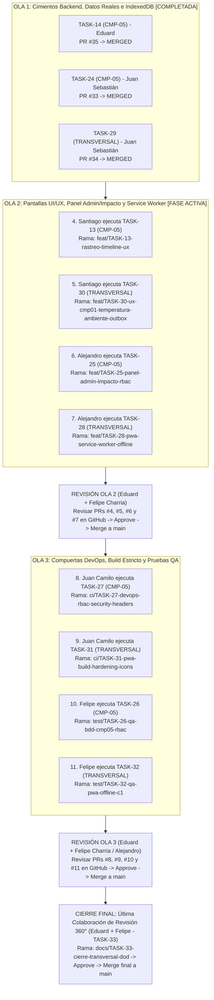

# Manual Operativo del Product Owner: Guía de Ejecución por Olas, Entrega de Prompts y Revisión de PRs

Este documento es tu **Guía Maestra de Coordinación** (para **Eduard Criollo Yule — Product Owner**) para dirigir la ejecución y cierre de los últimos dos bloques del proyecto (**Comportamiento 5 (`CMP-05`)** y **Comportamiento Transversal (`TRANSVERSAL` / PWA Offline-First + Ajustes `CMP-01`)**).

> [!NOTE]
> **ESTADO GENERAL DEL PROYECTO: OLA 1 FINALIZADA Y FUSIONADA EN `main`**
> - **Ola 1 (`TASK-14`, `TASK-24`, `TASK-29`):** 100% implementada, aprobada por QA (`divdevu`) y fusionada en `main`.
> - **Fase Activa Inmediata:** **OLA 2** (Santiago Valencia y Alejandro Rodríguez).

---

## 🚀 Archivos Consolidados por Fase (Listos para Despacho)

Para facilitar la coordinación, dispones de dos modalidades:
1. **Archivos Consolidados por Fase:**
   - [OLA_2_PROMPTS_COLABORADORES.md](./OLA_2_PROMPTS_COLABORADORES.md) *(Todo lo que necesitan Santiago y Alejandro en la Ola 2).*
   - [OLA_3_PROMPTS_COLABORADORES.md](./OLA_3_PROMPTS_COLABORADORES.md) *(Todo lo que necesitan Juan Camilo, Felipe y Eduard en la Ola 3).*
2. **Cuadernos Individuales por Colaborador:** Carpeta [`por_colaborador/`](./por_colaborador/) para entregar a cada persona exclusivamente su archivo.

---

## Mapa General de las Olas y Cierre de Revisión Final



---

## Guía de Despacho Paso a Paso

### 🟡 OLA 2: Vistas UI/UX, Panel Admin/Impacto, Avisos Legales C1 y Service Worker PWA
**¿Quiénes trabajan en la Ola 2?** **Santiago Valencia Sandoval** y **Alejandro Rodríguez Cortés**.

1. **Qué entregarles:**
   - Puedes enviarles el documento unificado [OLA_2_PROMPTS_COLABORADORES.md](./OLA_2_PROMPTS_COLABORADORES.md) o sus cuadernos individuales:
     * A **Santiago Valencia Sandoval**: [`por_colaborador/04_Santiago_Valencia_Sandoval_UX_Designer.md`](./por_colaborador/04_Santiago_Valencia_Sandoval_UX_Designer.md).
     * A **Alejandro Rodríguez Cortés**: [`por_colaborador/02_Alejandro_Rodriguez_Cortes_Full_Stack.md`](./por_colaborador/02_Alejandro_Rodriguez_Cortes_Full_Stack.md).
   - Ambos deben ejecutar primero:
     ```bash
     git checkout main
     git pull origin main
     ```
2. **Sesión de Revisión y Merge (Cierre de Ola 2):**
   - Te reúnes con **Felipe Charria Caicedo (QA)** en GitHub Pull Requests.
   - Revisan los 4 PRs (`TASK-13`, `TASK-30`, `TASK-25`, `TASK-28`), verifican que pasen CI y dan clic en **Approve** y **Merge pull request**.

---

### 🔵 OLA 3: Compuertas DevOps, Endurecimiento de Build y Certificación Automatizada QA
**¿Quiénes trabajan en la Ola 3?** **Juan Camilo Peña Sandoval (DevOps)** y **Felipe Charria Caicedo (QA)**.

1. **Qué entregarles:**
   - El documento unificado [OLA_3_PROMPTS_COLABORADORES.md](./OLA_3_PROMPTS_COLABORADORES.md) o sus cuadernos individuales:
     * A **Juan Camilo Peña Sandoval**: [`por_colaborador/06_Juan_Camilo_Pena_Sandoval_DevOps.md`](./por_colaborador/06_Juan_Camilo_Pena_Sandoval_DevOps.md).
     * A **Felipe Charria Caicedo**: [`por_colaborador/05_Felipe_Charria_Caicedo_QA_Engineer.md`](./por_colaborador/05_Felipe_Charria_Caicedo_QA_Engineer.md).
2. **Sesión de Revisión y Merge (Cierre de Ola 3):**
   - **PRs de Juan Camilo (`TASK-27` y `TASK-31`):** Aprobados por **Eduard** y **Felipe Charria** $\rightarrow$ Merge a `main`.
   - **PRs de Felipe Charria (`TASK-26` y `TASK-32`):** Aprobados por **Eduard** y **Alejandro Rodríguez** $\rightarrow$ Merge a `main`.

---

### 🟣 ETAPA FINAL (Última Colaboración): Revisión Transversal 360° y Cierre del Proyecto (`TASK-33`)
**¿Cuándo se ejecuta?** Cuando las 3 Olas anteriores ya están fusionadas en `main`.  
**¿Quiénes participan?** **Tú (Eduard Criollo Yule)** junto con tu compañero de revisión (**Felipe Charria Caicedo**).

1. Ambos prueban la aplicación completa en modo offline y online.
2. Tú ejecutas `TASK-33`, marcas todas las casillas `[x]` pendientes en la documentación y abres el PR final.
3. Felipe Charria aprueba el PR y tú ejecutas el **Merge final a `main`**.

---

## Índice de Cuadernos Individuales Listos para Enviar

| Orden de Envío | Colaborador | Archivo Único Individual | Tareas Activas que Contiene |
| :---: | :--- | :--- | :--- |
| **OLA 1 (Listo)** | **Eduard Criollo Yule** | [`por_colaborador/01_Eduard_Criollo_Yule_Product_Owner.md`](./por_colaborador/01_Eduard_Criollo_Yule_Product_Owner.md) | `TASK-14` (Completada) y `TASK-33` (Cierre Final) |
| **OLA 1 (Listo)** | **Juan Sebastián Delgado** | [`por_colaborador/03_Juan_Sebastian_Delgado_Backend.md`](./por_colaborador/03_Juan_Sebastian_Delgado_Backend.md) | `TASK-24` (Completada) y `TASK-29` (Completada) |
| **OLA 2 (Activa)** | **Santiago Valencia Sandoval** | [`por_colaborador/04_Santiago_Valencia_Sandoval_UX_Designer.md`](./por_colaborador/04_Santiago_Valencia_Sandoval_UX_Designer.md) | `TASK-13` (`CMP-05`) y `TASK-30` (`TRANSVERSAL`) |
| **OLA 2 (Activa)** | **Alejandro Rodríguez Cortés** | [`por_colaborador/02_Alejandro_Rodriguez_Cortes_Full_Stack.md`](./por_colaborador/02_Alejandro_Rodriguez_Cortes_Full_Stack.md) | `TASK-25` (`CMP-05`) y `TASK-28` (`TRANSVERSAL`) |
| **OLA 3** | **Juan Camilo Peña Sandoval** | [`por_colaborador/06_Juan_Camilo_Pena_Sandoval_DevOps.md`](./por_colaborador/06_Juan_Camilo_Pena_Sandoval_DevOps.md) | `TASK-27` (`CMP-05`) y `TASK-31` (`TRANSVERSAL`) |
| **OLA 3** | **Felipe Charria Caicedo** | [`por_colaborador/05_Felipe_Charria_Caicedo_QA_Engineer.md`](./por_colaborador/05_Felipe_Charria_Caicedo_QA_Engineer.md) | `TASK-26` (`CMP-05`) y `TASK-32` (`TRANSVERSAL`) |
